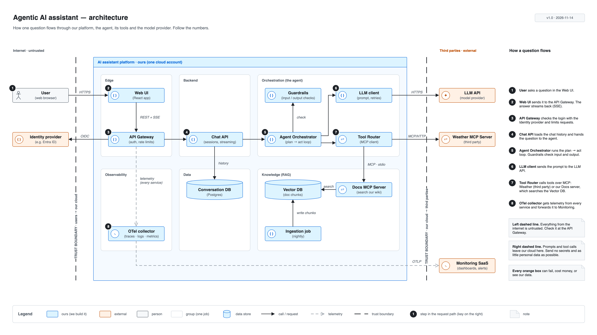

# ArchitecturalDiagrams

**Learning to draw clear software architecture diagrams in 30 days, one diagram a day.**
Every diagram is drawn in [Draw.io](https://app.diagrams.net). Started 2026-11-07 · target 2026-12-06 · **21 of 30 days done.**


*Best diagram so far ([Day 21](diagramming-30-days/day-21-week3-review/README.md)): the whole AI assistant on one slide.*

---

## What is being built here?

Every day draws **the same imaginary product**, an **AI assistant** (a chatbot), from a different angle:

- A **user** asks a question in a web app.
- An **agent** sends it to an **LLM** (the AI model) and calls **tools** over **MCP** (a standard way for an AI app to talk to tools).
- It looks things up in our own documents with **RAG** (search the docs first, then answer).

Using one product the whole time means each day adds a new **kind** of diagram, or a better **look**, to something you already know. By Day 30 the repo holds a full design pack for this assistant.

### New to the words?
| Word | Plain meaning |
|---|---|
| **LLM** | The AI model that writes the answers (for example, GPT or Claude) |
| **Agent** | Code that lets the LLM plan, call tools, and try again |
| **MCP** | A standard "plug" between an AI app and its tools |
| **RAG** | Search our documents first, then give the results to the LLM |
| **Sequence diagram** | Who talks to whom, in what order, top to bottom |
| **Flowchart** | Steps and decisions (yes/no) |
| **Architecture diagram** | The parts of a system and how they connect |

---

## How the 30 days fit together

```
Week 1  Foundations        learn the 2 basic diagrams: flowchart + sequence
   │
Week 2  Diagram types      add class, ER (database), state diagrams → mini design pack
   │
Week 3  Visual design      make it look professional: layout, style guide, reusable shapes
   │
Week 4  Real-world         RAG, multi-agent, LangGraph, MCP, Kubernetes → final portfolio
```

Each week ends with a **review day** (7, 14, 21, 28–30) that pulls the week together into one finished piece.

### Four storylines run through the days
Many days build directly on an earlier day. Follow a line from left to right to watch one diagram grow up.

| Storyline | Days | What happens |
|---|---|---|
| 🗣️ **Chatbot flowchart** | [02](diagramming-30-days/day-02-flowchart-fundamentals/README.md) → [03](diagramming-30-days/day-03-flowchart-refinement/README.md) → [08](diagramming-30-days/day-08-drawio-workflow/README.md) | A simple support-bot flowchart gets retries and fallbacks, then becomes a tidy multi-page Draw.io file |
| 🔁 **MCP tool call (sequence)** | [05](diagramming-30-days/day-05-sequence-notation/README.md) → [06](diagramming-30-days/day-06-sequence-control-flow/README.md) → [07](diagramming-30-days/day-07-week1-review/README.md) → [09](diagramming-30-days/day-09-sequence-patterns/README.md) → [15](diagramming-30-days/day-15-canvas-setup/README.md) → [16](diagramming-30-days/day-16-shapes-connectors/README.md) → [17](diagramming-30-days/day-17-layout-alignment/README.md) → [18](diagramming-30-days/day-18-visual-design-system/README.md) | The same "AI calls a tool" story, from first sketch to a polished, styled diagram |
| 🧱 **Inside the agent** | [11](diagramming-30-days/day-11-class-diagrams/README.md) → [12](diagramming-30-days/day-12-er-diagrams/README.md) → [13](diagramming-30-days/day-13-state-diagrams/README.md) → [14](diagramming-30-days/day-14-week2-review/README.md) | What the code looks like, how chats are stored, and the life of a task, all joined into one design pack |
| 🏗️ **Whole system (architecture)** | [01](diagramming-30-days/day-01-foundations/README.md) → [19](diagramming-30-days/day-19-architecture-composition/README.md) → [20](diagramming-30-days/day-20-reusable-components/README.md) → [21](diagramming-30-days/day-21-week3-review/README.md) | A rough context sketch becomes a full architecture, then gets a shape library and a slide-ready version |

Two shared tools are used from Day 18 on:
- **[Style guide](diagramming-30-days/day-18-visual-design-system/STYLE_GUIDE.md)**: blue = ours, orange = external, red = errors only.
- **[Shape library](diagramming-30-days/day-20-reusable-components/day20-component-library.xml)**: ready-made Draw.io shapes in that style.

---

## How to find your way around

```
README.md                      ← you are here: the map
diagramming-30-days/
  day-01-foundations/          ← one folder per day
    README.md                  ← start here: what we did + how to read the diagram
    day01-*.drawio             ← the editable source
    day01-*.png / .svg         ← the picture
  day-02-.../
  ...
```

- **Want the quick tour?** Read the four storylines above.
- **Want one day?** Click its number in the tables below. Every day's README has the same parts: *What we did · Diagram · How to read it · Key ideas*.
- **Want to edit a diagram?** Open the `.drawio` or `.drawio.svg` file in [draw.io](https://app.diagrams.net) or the VS Code Draw.io extension. `.drawio.svg` files also show as normal images on GitHub.

---

## Every day

### Week 1: Foundations ✅
**Goal:** learn the two basic diagrams. Milestone: redraw the MCP sequence from memory (Day 07).

| Day | Topic | What we built | Builds on | Diagrams |
|---|---|---|---|---|
| [01](diagramming-30-days/day-01-foundations/README.md) | Diagramming foundations | Context sketch of the AI assistant, plus a data-flow diagram with an animated step-through player | — | [context](diagramming-30-days/day-01-foundations/day01-ai-assistant-context.drawio) · [data flow](diagramming-30-days/day-01-foundations/day01-ai-assistant-dataflow.svg) · [player](diagramming-30-days/day-01-foundations/day01-ai-assistant-dataflow-player.html) |
| [02](diagramming-30-days/day-02-flowchart-fundamentals/README.md) | Flowchart fundamentals | Support chatbot flowchart with the 5 basic shapes, and the same story as a sequence | — | [flowchart](diagramming-30-days/day-02-flowchart-fundamentals/day02-support-chatbot-flowchart.drawio.svg) · [sequence](diagramming-30-days/day-02-flowchart-fundamentals/day02-support-chatbot-sequence.drawio.svg) |
| [03](diagramming-30-days/day-03-flowchart-refinement/README.md) | Flowchart refinement | Chatbot flowchart v2: time limit, retries, backup answer, hand-off to a person | 02 | [flowchart v2](diagramming-30-days/day-03-flowchart-refinement/day03-support-chatbot-flowchart-v2.drawio.svg) |
| [04](diagramming-30-days/day-04-sequence-foundations/README.md) | Sequence foundations | First full sequence: a "My orders" request through Gateway → Auth → Orders → DB | — | [sequence](diagramming-30-days/day-04-sequence-foundations/day04-orders-request-sequence.drawio.svg) |
| [05](diagramming-30-days/day-05-sequence-notation/README.md) | Sequence notation | MCP sequence v1 (sync, async, notes, numbering), plus the same story as a flowchart | 04 | [sequence v1](diagramming-30-days/day-05-sequence-notation/day05-mcp-sequence-v1.drawio.svg) · [flowchart](diagramming-30-days/day-05-sequence-notation/day05-mcp-flowchart.drawio.svg) |
| [06](diagramming-30-days/day-06-sequence-control-flow/README.md) | Sequence control flow | MCP sequence v2 with `loop`, `alt` and `ref` boxes for errors, timeouts and the tool limit | 05 | [sequence v2](diagramming-30-days/day-06-sequence-control-flow/day06-mcp-sequence-v2.drawio.svg) |
| [07](diagramming-30-days/day-07-week1-review/README.md) | Week 1 review | MCP sequence v3 redrawn from memory, with 5 improvements | 05, 06 | [sequence v3](diagramming-30-days/day-07-week1-review/day07-mcp-sequence-v3.drawio.svg) |

### Week 2: Diagram types ✅
**Goal:** learn more diagram types and when to use each. Milestone: a mini design pack (Day 14).

| Day | Topic | What we built | Builds on | Diagrams |
|---|---|---|---|---|
| [08](diagramming-30-days/day-08-drawio-workflow/README.md) | Draw.io workflow | One `.drawio` file with 2 pages (flowchart + sequence), layers, tooltips, page links, PNG exports | 02, 03 | [source](diagramming-30-days/day-08-drawio-workflow/day08-chatbot-pack.drawio) · [flowchart](diagramming-30-days/day-08-drawio-workflow/day08-flowchart.png) · [sequence](diagramming-30-days/day-08-drawio-workflow/day08-sequence.png) |
| [09](diagramming-30-days/day-09-sequence-patterns/README.md) | Sequence patterns | Production-style LLM tool-call sequence (7 participants): what the model *asks* vs what the app *runs* | 07 | [sequence](diagramming-30-days/day-09-sequence-patterns/day09-llm-tool-call-sequence.drawio.svg) |
| [10](diagramming-30-days/day-10-flowchart-patterns/README.md) | Flowchart patterns | RAG request flowchart in 4 stages, with a no-results fallback | 03 | [flowchart](diagramming-30-days/day-10-flowchart-patterns/day10-rag-request-flowchart.drawio.svg) |
| [11](diagramming-30-days/day-11-class-diagrams/README.md) | Class diagrams | Agent / Tool / ToolCall / ToolResult / Message classes and how they relate | 09 | [class diagram](diagramming-30-days/day-11-class-diagrams/day11-agent-tool-classes.drawio.svg) |
| [12](diagramming-30-days/day-12-er-diagrams/README.md) | ER diagrams | Database tables for storing conversations, with keys and "one-to-many" links | 11 | [ERD](diagramming-30-days/day-12-er-diagrams/day12-conversation-erd.drawio.svg) |
| [13](diagramming-30-days/day-13-state-diagrams/README.md) | State diagrams | Life of an agent task: from created to completed, failed or cancelled | 11 | [state diagram](diagramming-30-days/day-13-state-diagrams/day13-agent-task-states.drawio.svg) |
| [14](diagramming-30-days/day-14-week2-review/README.md) | Week 2 review | Mini design pack: one 4-page file where sequence, flowchart and state diagrams each answer their own question | 08–13 | [source](diagramming-30-days/day-14-week2-review/day14-design-pack.drawio) · [overview](diagramming-30-days/day-14-week2-review/day14-1-overview.png) · [sequence](diagramming-30-days/day-14-week2-review/day14-2-sequence.png) · [flowchart](diagramming-30-days/day-14-week2-review/day14-3-flowchart.png) · [state](diagramming-30-days/day-14-week2-review/day14-4-state.png) |

### Week 3: Visual design ✅
**Goal:** make diagrams look professional. Milestone: a polished Agentic AI architecture (Day 21).

| Day | Topic | What we built | Builds on | Diagrams |
|---|---|---|---|---|
| [15](diagramming-30-days/day-15-canvas-setup/README.md) | Canvas setup | MCP layout skeleton: measured page, grid, evenly spaced participants, layers, legend strip | 07 | [source](diagramming-30-days/day-15-canvas-setup/day15-mcp-skeleton.drawio) · [skeleton](diagramming-30-days/day-15-canvas-setup/day15-skeleton.png) · [with guides](diagramming-30-days/day-15-canvas-setup/day15-skeleton-guides.png) |
| [16](diagramming-30-days/day-16-shapes-connectors/README.md) | Shapes & connectors | Full 15-message MCP sequence on that skeleton, one arrow style per message kind | 15 | [source](diagramming-30-days/day-16-shapes-connectors/day16-mcp-sequence.drawio) · [sequence](diagramming-30-days/day-16-shapes-connectors/day16-mcp-sequence.png) · [with guides](diagramming-30-days/day-16-shapes-connectors/day16-mcp-sequence-guides.png) |
| [17](diagramming-30-days/day-17-layout-alignment/README.md) | Layout & alignment | Polished MCP v1: 7 layout fixes (even rhythm, equal boxes, aligned edges) | 16 | [source](diagramming-30-days/day-17-layout-alignment/day17-mcp-sequence-v1.drawio) · [v1](diagramming-30-days/day-17-layout-alignment/day17-mcp-sequence-v1.png) · [with guides](diagramming-30-days/day-17-layout-alignment/day17-mcp-sequence-v1-guides.png) |
| [18](diagramming-30-days/day-18-visual-design-system/README.md) | Visual design system | Personal style guide (3 colours with fixed meanings, 1 font, set line weights and spacing) applied to the MCP diagram | 17 | [style guide (md)](diagramming-30-days/day-18-visual-design-system/STYLE_GUIDE.md) · [source](diagramming-30-days/day-18-visual-design-system/day18-style-guide-and-mcp.drawio) · [style guide](diagramming-30-days/day-18-visual-design-system/day18-style-guide.png) · [styled MCP](diagramming-30-days/day-18-visual-design-system/day18-mcp-sequence-styled.png) |
| [19](diagramming-30-days/day-19-architecture-composition/README.md) | Architecture composition | First full architecture of the AI assistant: 6 groups, 4 external systems, 2 trust boundaries | 01, 18 | [source](diagramming-30-days/day-19-architecture-composition/day19-ai-assistant-architecture.drawio) · [architecture](diagramming-30-days/day-19-architecture-composition/day19-ai-assistant-architecture.png) |
| [20](diagramming-30-days/day-20-reusable-components/README.md) | Reusable components | Draw.io shape library (14 shapes in the house style), a library sheet, and an example built only from it | 18, 19 | [library (.xml)](diagramming-30-days/day-20-reusable-components/day20-component-library.xml) · [source](diagramming-30-days/day-20-reusable-components/day20-components.drawio) · [sheet](diagramming-30-days/day-20-reusable-components/day20-sheet.png) · [example](diagramming-30-days/day-20-reusable-components/day20-example.png) |
| [21](diagramming-30-days/day-21-week3-review/README.md) | Week 3 review | Slide-ready AI assistant architecture: 16:9, library shapes, numbered request path with a step key, SVG + PNG | 19, 20 | [source](diagramming-30-days/day-21-week3-review/day21-agentic-ai-architecture.drawio) · [SVG](diagramming-30-days/day-21-week3-review/day21-agentic-ai-architecture.drawio.svg) · [PNG](diagramming-30-days/day-21-week3-review/day21-agentic-ai-architecture.png) |

### Week 4: Real-world architecture ⬜
**Goal:** draw the kinds of systems real teams build. Milestone: an enterprise knowledge-assistant pack. *Coming next.*

| Day | Topic | What we will build | Builds on |
|---|---|---|---|
| 22 | RAG architecture | Document ingestion parts + a query sequence | 10, 19 |
| 23 | Multi-agent | A "supervisor" agent that hands work to other agents | 19 |
| 24 | LangGraph workflow | Planner → executor → validator graph | 13 |
| 25 | MCP deep dive | MCP at two zoom levels (C4 context and containers) + tool discovery sequence | 09, 18 |
| 26 | API & microservices | Document-processing services + sequence | 19 |
| 27 | Deployment | Where everything runs on Kubernetes | 20 |
| 28 | Capstone v1 | One pack: context, containers, sequence, deployment | 22–27 |
| 29 | Review & critique | Capstone v2 + review notes | 28 |
| 30 | Final portfolio | Polished pack + a short design note (assumptions, trade-offs, risks) | 29 |

---

## How to open the diagrams
- **Just look:** click any `.png` or `.drawio.svg` link. They show right on GitHub.
- **Edit:** open `.drawio` or `.drawio.svg` in [draw.io](https://app.diagrams.net) (*File → Open from → Device*) or in VS Code with the Draw.io extension.
- **Use the shapes:** in Draw.io, *File → Open Library from → Device* → [day20-component-library.xml](diagramming-30-days/day-20-reusable-components/day20-component-library.xml).
