# Day 01 — Diagramming foundations

## What we did
- Drew a context sketch in Draw.io: User → AI Assistant → Azure OpenAI.
- Fixed it: attached arrows, one-way labelled arrows, added the app layer, title, legend, flow animation.
- Built a data-flow diagram with Conversation DB and an animated step-through player.

## Diagram

① question → ② load history → ③ history → ④ prompt + history → ⑤ completion → ⑥ save turn → ⑦ answer

## Lessons
- Attach both arrow ends to shapes.
- One-way labelled arrows, not double-headed.
- Users never call the LLM directly; the app sits between.
- When order matters, use a sequence diagram.

