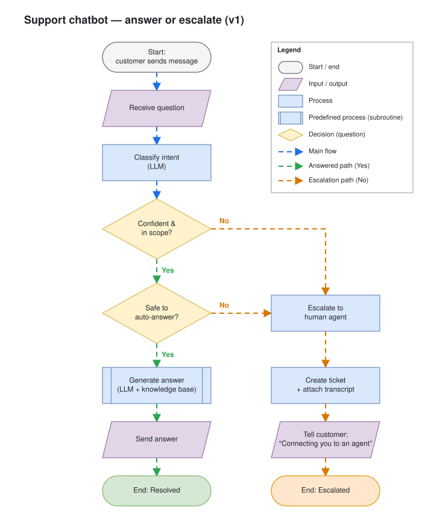
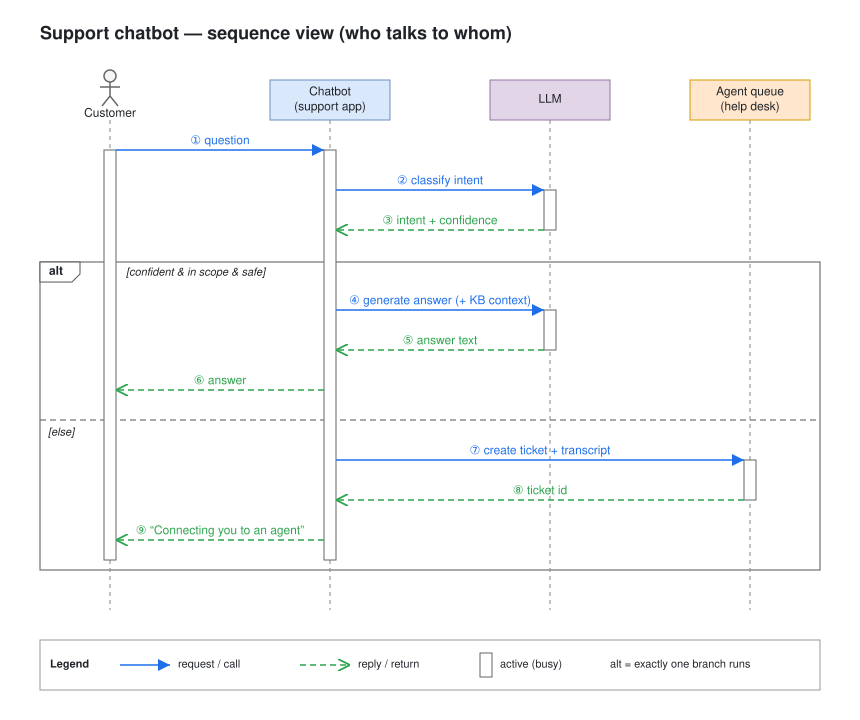

# Day 02 — Flowchart fundamentals

## What we did
- Flowchart v1 for a support chatbot: receive question → classify → answer or escalate.
- Used the five core flowchart shapes, each in one consistent colour.
- Two decisions, both with labelled exits (Yes = down, No = right).
- Happy path as a straight vertical spine; escalation as a parallel column with its own end.

## Diagram

Open the `.drawio.svg` in Draw.io (or the VS Code Draw.io extension) to edit — the editable model is embedded in the SVG.

## How the parts connect
| From | Condition | To | Why |
|---|---|---|---|
| Classify intent | — | Confident & in scope? | Classifier output gates everything after it |
| Confident & in scope? | No | Escalate | Bot doesn't understand / out of scope → don't guess |
| Confident & in scope? | Yes | Safe to auto-answer? | Understood, but some topics need a human |
| Safe to auto-answer? | No | Escalate | Billing, complaints, sensitive data |
| Safe to auto-answer? | Yes | Generate answer → Send → Resolved | Happy path |
| Escalate | — | Create ticket → Tell customer → Escalated | Both "No" branches merge into one path |

## Bonus: same chatbot as a sequence diagram

① question → ② classify intent → ③ intent + confidence → **alt** [confident & in scope & safe] ④ generate answer → ⑤ answer text → ⑥ answer · **[else]** ⑦ create ticket → ⑧ ticket id → ⑨ "Connecting you to an agent"

## Flowchart vs sequence diagram
Same system, different question → different diagram.

| | Flowchart | Sequence diagram |
|---|---|---|
| Answers | *What logic runs, and where does it branch?* | *Who talks to whom, in what order?* |
| Boxes are | **Steps** (process, decision, I/O) | **Participants** (Customer, Chatbot, LLM, Agent queue) |
| Layout | Flow follows steps (top-down), branches to the side | One column per participant; **time runs down** |
| Arrow means | "then do the next step" | "sends this message to" |
| Decisions | Diamonds with labelled exits | `alt` / `opt` frames with `[guard]` conditions |
| Loops | Arrow back up | `loop` frame |
| Replies | Not shown | Dashed return arrows |
| Shows well | Business rules, every branch, every end state | Integration points, call/reply pairs, who waits on whom |
| Hides | Which component does each step | Fine-grained branching logic |

What each diagram revealed here:
- **Flowchart** shows the *two separate gates* (confidence, then safety) and both end states clearly. It hides that the LLM is a separate service called twice.
- **Sequence** shows the *Chatbot is the hub*: Customer never talks to the LLM or help desk directly, the LLM is called twice, and the help desk returns a ticket id. The two gates collapse into one `alt` guard.

Rule of thumb: drawing **branches** → flowchart. Drawing **messages between parts** → sequence.

## Lessons
- Shape = meaning: terminator, I/O, process, predefined process, decision.
- Diamonds ask a question; every exit is labelled; exits cover all cases.
- Same answer, same direction (Yes down, No right) — reader learns the pattern once.
- Merge branches into one path instead of duplicating boxes.
- Every path ends at a terminator.
- Out of scope for v1: retry, timeout, fallback → Day 03.
- Sequence notation: solid arrow = call, dashed arrow = reply, white bar = participant busy, `alt` = exactly one branch runs.
- Sequence diagram has no flow animation on purpose — dashed already means "reply", animated dashes would blur that.
