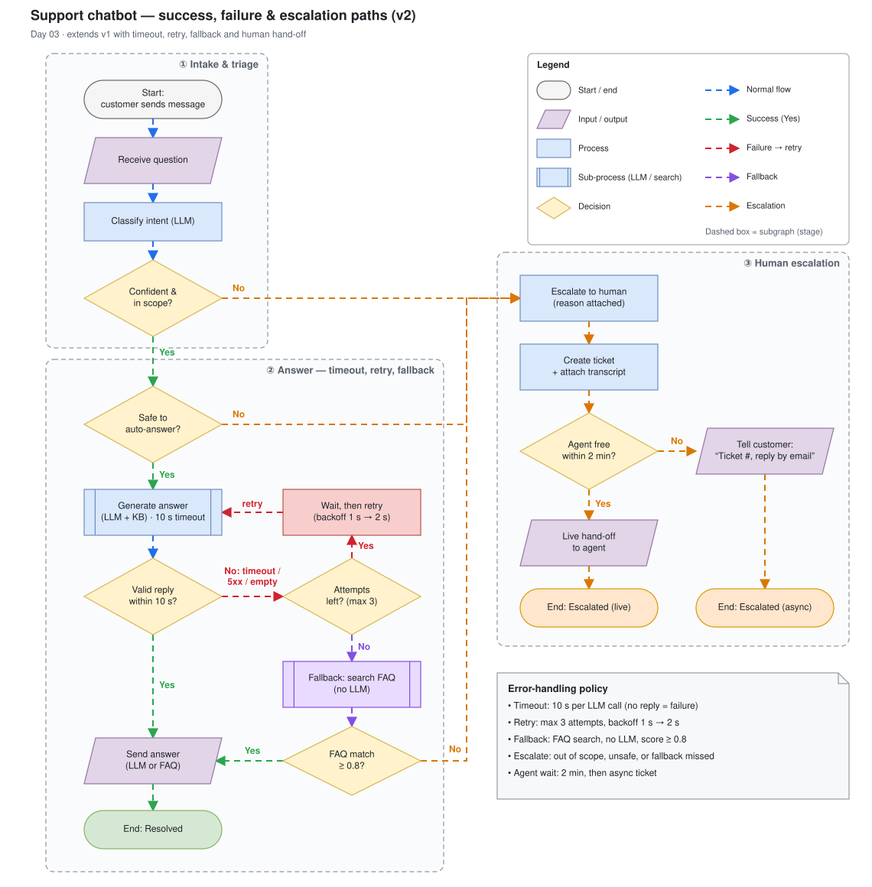

# Day 03 — Flowchart refinement

## What we did
- Flowchart v2 of the Day 02 support chatbot, now with success, failure and escalation paths.
- Added a **timeout** (10 s per LLM call) and a **retry** loop (max 3 attempts, backoff 1 s → 2 s).
- Added a **fallback**: when retries run out, search the FAQ with no LLM and send the answer if the match is ≥ 0.8.
- **Human escalation** gets its own timeout: agent free within 2 min → live hand-off, otherwise an async ticket.
- Grouped steps into 3 **subgraphs** (Intake & triage · Answer · Human escalation) and labelled every decision exit.
- No crossing arrows: success runs down the left, recovery sits in the middle, humans on the right, and all "No → escalate" exits join one orange lane.

## Diagram

## The four Day 03 techniques
### 1. Subgraphs (containers)
- Group steps into **stages** that answer "which phase are we in?": intake, answering, escalation.
- Draw.io: *Arrange → Insert → Container*, or drop a rectangle and turn on `container=1`. Drag steps inside it and they become children.
- Keep stage titles short and numbered (①②③) so the reading order is clear.
- Put the header where no arrow passes through it. Here the headers are right-aligned because the main spine runs down the left.

The three subgraphs in this diagram (the dashed boxes):

| Subgraph | Steps inside | Question it answers |
|---|---|---|
| **① Intake & triage** | Start → Receive question → Classify intent (LLM) → *Confident & in scope?* | Do we understand the question? |
| **② Answer — timeout, retry, fallback** | *Safe to auto-answer?* → Generate answer → *Valid reply within 10 s?* → retry loop (*Attempts left?* → Wait) → Fallback: search FAQ → *FAQ match ≥ 0.8?* → Send answer → End: Resolved | Can the bot answer, even when the LLM fails? |
| **③ Human escalation** | Escalate to human → Create ticket → *Agent free within 2 min?* → Live hand-off or "Ticket #, reply by email" → End: Escalated (live / async) | How does a person take over? |

- Arrows that cross between subgraphs mark a change of stage. For example, every orange arrow into ③ means "a person takes over".
- The legend and the policy note sit outside the subgraphs because they are not steps in the flow.

### 2. Node labels
- Process = **verb + object** ("Create ticket", "Generate answer").
- Decision = a **closed question** that ends in `?` ("Valid reply within 10 s?").
- Put the **threshold in the label** (10 s, max 3, ≥ 0.8, 2 min). That turns a vague box into a rule someone can test.

The node labels in this diagram, by shape:

| Shape | Labels |
|---|---|
| Start / end (terminator) | Start: customer sends message · End: Resolved · End: Escalated (live) · End: Escalated (async) |
| Input / output (parallelogram) | Receive question · Send answer (LLM or FAQ) · Live hand-off to agent · Tell customer: "Ticket #, reply by email" |
| Process (rectangle) | Classify intent (LLM) · Wait, then retry (backoff 1 s → 2 s) · Escalate to human (reason attached) · Create ticket + attach transcript |
| Sub-process (double-sided box) | Generate answer (LLM + KB) · 10 s timeout · Fallback: search FAQ (no LLM) |
| Decision (diamond) | Confident & in scope? · Safe to auto-answer? · Valid reply within 10 s? · Attempts left? (max 3) · FAQ match ≥ 0.8? · Agent free within 2 min? |

- Every decision is a yes/no question, and four of the six carry a number (10 s, max 3, ≥ 0.8, 2 min).
- "Wait, then retry" is red and "Fallback" is purple, so the recovery steps stand out from the normal blue ones.

### 3. Edge labels
- Label every edge that leaves a diamond. Don't label edges that are obvious (step → next step).
- When there are many ways to fail, say which ones: "No: timeout / 5xx / empty" is better than "No".
- Name the edge that loops back ("retry") so the reader sees that it is a loop and not a mistake.
- Draw.io: double-click an edge to type a label, and drag the yellow handle to move it. Give the label a white background so it stays readable over the line.

The edge labels in this diagram:

| Edge | Label | Colour | Why it's labelled |
|---|---|---|---|
| Confident & in scope? → Safe to auto-answer? | Yes | green | Decision exit |
| Confident & in scope? → Escalate to human | No | orange | Decision exit |
| Safe to auto-answer? → Generate answer | Yes | green | Decision exit |
| Safe to auto-answer? → Escalate to human | No | orange | Decision exit |
| Valid reply within 10 s? → Send answer | Yes | green | Decision exit |
| Valid reply within 10 s? → Attempts left? | No: timeout / 5xx / empty | red | Names the three ways the LLM call can fail |
| Attempts left? → Wait, then retry | Yes | red | Decision exit |
| Wait, then retry → Generate answer | retry | red | Shows the backward arrow is a deliberate loop |
| Attempts left? → Fallback: search FAQ | No | purple | Decision exit |
| FAQ match ≥ 0.8? → Send answer | Yes | green | Decision exit |
| FAQ match ≥ 0.8? → Escalate to human | No | orange | Decision exit |
| Agent free within 2 min? → Live hand-off | Yes | orange | Decision exit |
| Agent free within 2 min? → Tell customer | No | orange | Decision exit |

- Straight step → step arrows (Start → Receive question, Create ticket → Agent free?, …) have no label, because the direction says it all.
- The colour is part of the label: the same "No" is orange when it escalates and purple when it falls back.

### 4. Error paths
- Every failure needs to **go somewhere**. No dead ends, no "???".
- Order of defence: **retry** (temporary error) → **fallback** (cheaper or simpler answer) → **escalate** (a human).
- Each loop needs a **limit** (max 3). An unbounded loop in a diagram becomes an unbounded loop in production.
- Waiting on a human needs a timeout too (2 min → async ticket).

The error paths in this diagram:

| # | Error | Detected at | Handling | Where it ends |
|---|---|---|---|---|
| 1 | Question not understood or out of scope | Confident & in scope? → No | Escalate straight away; don't guess | Escalated (live / async) |
| 2 | Sensitive topic (billing, complaint, personal data) | Safe to auto-answer? → No | Escalate straight away | Escalated (live / async) |
| 3 | LLM timeout, 5xx or empty reply | Valid reply within 10 s? → No | **Retry**: wait 1 s, then 2 s; up to 3 attempts | Back to Generate answer |
| 4 | All 3 attempts failed | Attempts left? → No | **Fallback**: FAQ search without the LLM | Resolved if FAQ match ≥ 0.8 |
| 5 | Fallback found no good match | FAQ match ≥ 0.8? → No | **Escalate** with the failure reason attached | Escalated (live / async) |
| 6 | No agent free | Agent free within 2 min? → No | Give the customer a ticket # and reply by email | Escalated (async) |

- Errors 3 → 4 → 5 form the defence chain: retry, then fallback, then a human.
- No error path is a dead end: every one reaches a terminator, and the only loop (retry) has a limit.

## Layout decisions (no crossing arrows)
- **Columns by role:** left = happy path, middle = recovery (retry + fallback), right = humans. Failure moves right and success moves down.
- **Escalation bus:** all three "No → escalate" exits join one orange vertical lane between stages ② and ③. That gives one entry point into ③ instead of three arrows weaving around it.
- **Merge, don't duplicate:** the FAQ answer reuses "Send answer" rather than having its own send step and end state.
- **Retry loop stays local:** the loop runs from Generate → decision → Attempts left? → Wait → Generate, all in a small square, so it doesn't cross the main spine.
- One exception to "Yes = down": *FAQ match → Yes* points left, because it merges back into the success column. The green colour still marks it as a success.

