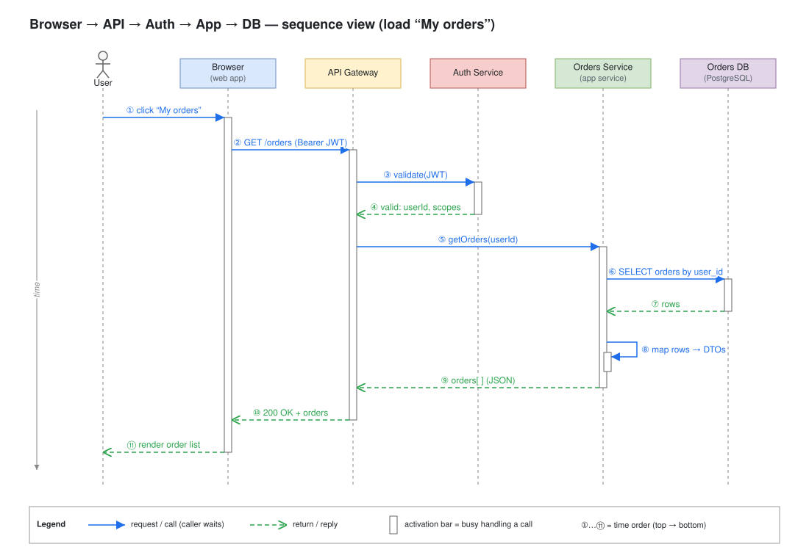

# Day 04 — Sequence diagram foundations

## What we did
- Drew my first full sequence diagram: a user opens **"My orders"** on a website.
- The request goes Browser → API Gateway → Auth Service → Orders Service → Database, and the answer comes back.
- Only the normal "everything works" path. Errors come in Day 06.

## Diagram

Open the `.drawio.svg` file in Draw.io (or the VS Code Draw.io extension) to edit it.

## How to read it
1. The user clicks "My orders".
2. The browser asks the API Gateway for the orders and sends the login token.
3. The gateway asks the Auth Service: *is this token OK?* Answer: yes, it's user 42.
4. The gateway asks the Orders Service for user 42's orders.
5. The Orders Service gets them from the database and tidies them up.
6. The orders go back up the chain, and the browser shows them.

## The 5 basics
| Part | Looks like | Means |
|---|---|---|
| **Participant** | Box at the top | Someone or something taking part (person, browser, service, database) |
| **Lifeline** | Dashed line going down | That participant's timeline |
| **Message** | Solid arrow, filled head | "Please do this" (a request) |
| **Reply** | Dashed arrow, open head | "Here's the answer" |
| **Activation bar** | Thin white box on a lifeline | "I'm busy with this right now" |

## Key ideas
- **Time goes down.** Lower on the page = later. The numbers ①…⑪ show the order.
- **Order the boxes by who gets called first.** Then requests point right, replies point left, and nothing crosses.
- **Activation bars sit inside each other.** The browser waits for the gateway, and the gateway waits for the Orders Service.
- **A message to yourself** (⑧ "map rows → DTOs") is work done inside one service.
- **Label replies with what comes back** ("rows", "200 OK + orders"), not just "return".

## Draw.io tip
*More shapes → UML → Lifeline* for each participant. For a person, use the stick-figure version (`participant=umlActor`).
