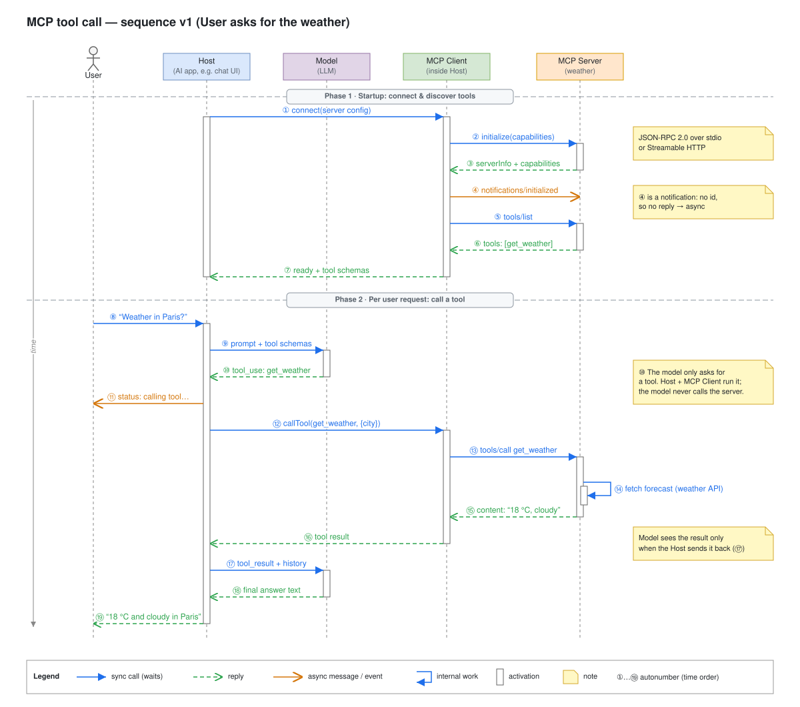
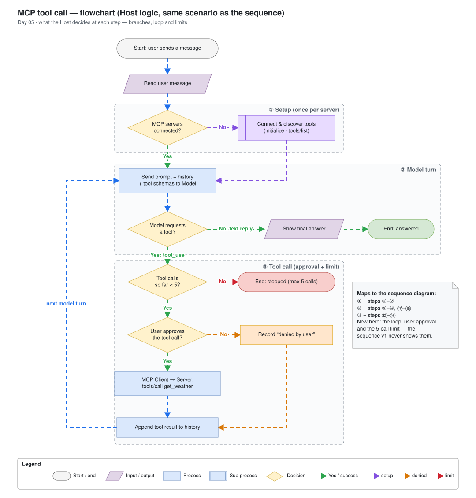

# Day 05 — Sequence diagram notation

## What we did
- Drew **MCP sequence v1**: a user asks *"Weather in Paris?"*, and the AI app answers it by using a weather tool.
- Five participants: **User, Host, Model, MCP Client, MCP Server**.
- Drew the same story as a **flowchart**, and wrote down when to use each one.
- Only the normal "everything works" path. Errors come in Day 06.

## Who's who
| Participant | In plain words |
|---|---|
| **User** | The person typing the question |
| **Host** | The AI app (e.g. a chat window). It runs the show. |
| **Model** | The LLM. It thinks and decides, but can't do anything by itself. |
| **MCP Client** | The part of the Host that talks to tool servers |
| **MCP Server** | Offers tools (here: `get_weather`) and runs them |

## Diagram 1: sequence (who talks to whom)

Open the `.drawio.svg` files in Draw.io (or the VS Code Draw.io extension) to edit them.

### How to read it
**Part 1: startup (once).** The Host connects to the weather server and asks what tools it has (①–⑦).

**Part 2: the question (every time).**
1. The user asks about the weather (⑧).
2. The Host sends the question to the Model, along with the list of tools (⑨).
3. The Model says: *"please run get_weather for Paris"* (⑩). It only **asks**; it can't run the tool itself.
4. The Host tells the user "calling tool…" (⑪).
5. The Host asks the server, through the MCP Client, to run the tool (⑫–⑬). The server gets the forecast (⑭).
6. The result goes back to the Host (⑮–⑯), and the Host gives it to the Model (⑰).
7. The Model writes the answer (⑱), and the user sees it (⑲).

### The 4 new things in this diagram
| Notation | Looks like | Means |
|---|---|---|
| **Sync message** | Blue, solid, filled arrowhead | "Do this, and I'll **wait** for your answer" |
| **Async message** | Orange, solid, open arrowhead | "FYI": **no answer expected** (④, ⑪) |
| **Note** | Yellow box with a folded corner | Extra explanation that an arrow can't show |
| **Numbering** | ①…⑲ | The order things happen. Makes it easy to say "step ⑩". |

Replies are green dashed arrows, the same as Day 04.

**Quick test for sync vs async:** does the sender wait for an answer? Yes = sync. No = async.

## Diagram 2: flowchart (what the Host decides)

### How to read it
1. **① Setup:** not connected to the server yet? Connect and get its tool list.
2. **② Ask the Model.** If it replies with text, show the answer. Done.
3. **③ The Model wants a tool:**
   - Already used 5 tools? **Stop.**
   - Does the user say OK to running the tool? If not, note "denied".
   - Run the tool, save the result, and **go back to ②**.

The flowchart shows things the sequence doesn't: the **loop** (the Model can ask for several tools), the **user OK**, and the **5-tool limit**.

## When to use which
Ask yourself one question:

> **Am I explaining *who talks to whom*, or *what decisions are made*?**

| Use a **sequence diagram** when… | Use a **flowchart** when… |
|---|---|
| Several systems pass messages to each other | You're showing one process and its choices |
| The **order** of messages matters | The **if / else** paths matter |
| You're explaining an API or protocol (like MCP) | You're explaining rules, steps or a workflow |
| You want to show who waits for whom | You want to show loops and limits |

**Easy rules:**
- Lots of **diamonds** (questions)? → Flowchart.
- Lots of **request → reply** pairs? → Sequence diagram.
- Important design? → Draw **both**. As here, each one shows something the other hides.
