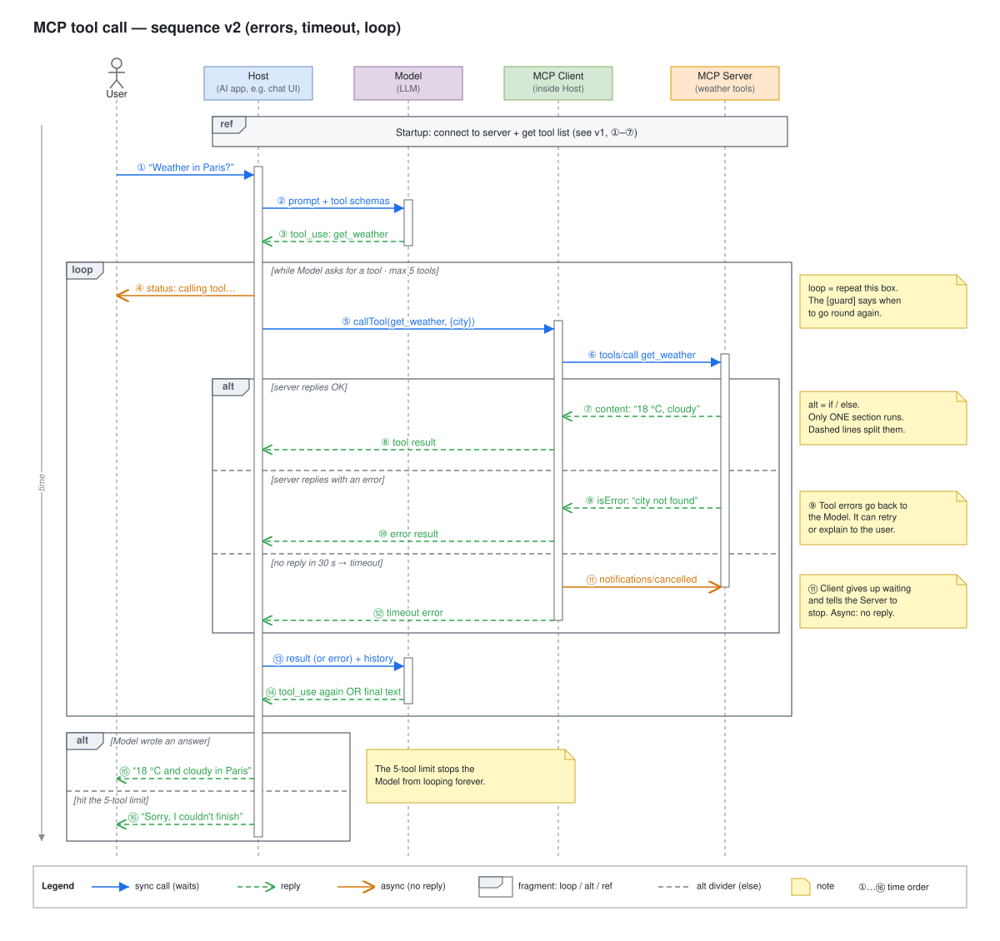

# Day 06 — Sequence control flow

## What we did
- Took the Day 05 weather story and added **what happens when things go wrong**.
- Drew **MCP sequence v2** with three new boxes: **`loop`**, **`alt`** and **`ref`**.
- Same five participants as Day 05: **User, Host, Model, MCP Client, MCP Server**.

## Diagram

Open the `.drawio.svg` file in Draw.io (or the VS Code Draw.io extension) to edit it.

## How to read it
1. **`ref` box at the top:** startup happens here, but we don't redraw it. It points back to Day 05 (①–⑦).
2. The user asks about the weather (①). The Model asks for the `get_weather` tool (②–③).
3. **`loop` box:** everything inside can happen again, as long as the Model keeps asking for tools, up to **5 times**.
4. The Host runs the tool through the MCP Client and Server (④–⑥).
5. **`alt` box inside the loop:** the server answers in **one** of three ways:
   - **OK:** the forecast comes back (⑦–⑧).
   - **Error:** the server says *"city not found"* (⑨–⑩).
   - **Timeout:** no answer in 30 s. The Client gives up and tells the Server to stop (⑪–⑫).
6. Whatever happened, the Host gives the result (or the error) to the Model (⑬). The Model either asks for another tool (go round the loop again) or writes the answer (⑭).
7. **`alt` box at the bottom:** the user gets the answer (⑮), or a "sorry" if the 5-tool limit was hit (⑯).

## The 3 new boxes
These boxes are called **fragments**. Each has a small tab in the top-left corner with its name.

| Box | Means | Everyday words |
|---|---|---|
| **`loop`** | Repeat the messages inside | "Keep doing this while…" |
| **`alt`** | Pick one of several paths | "If… else if… else…" |
| **`ref`** | This part is drawn somewhere else | "See the other diagram" |

Two more you'll see later: **`opt`** (an `alt` with only one path: "maybe do this") and **`par`** (things that happen at the same time).

## Key ideas
- **The guard** is the text in `[square brackets]`. It says *when* that box or section runs.
- **In an `alt`, only one section runs.** Dashed lines split the sections.
- **Errors are normal messages.** A tool error goes back to the Model like any other result, so the Model can try again or explain the problem.
- **Always have a way out of a loop.** Here it's the 5-tool limit. Without it, the Model could go round forever.
- **Timeouts need a clean-up.** When the Client stops waiting, it tells the Server to stop too (⑪). That message is async: no reply.

## Draw.io tip
*More shapes → UML → Frame* (`shape=umlFrame`) gives you the box with the name tab. Type `loop` or `alt` as its label. Add the guard as a separate text box, and draw the dashed split lines with a plain line (*Edit Style → `dashed=1`*).
