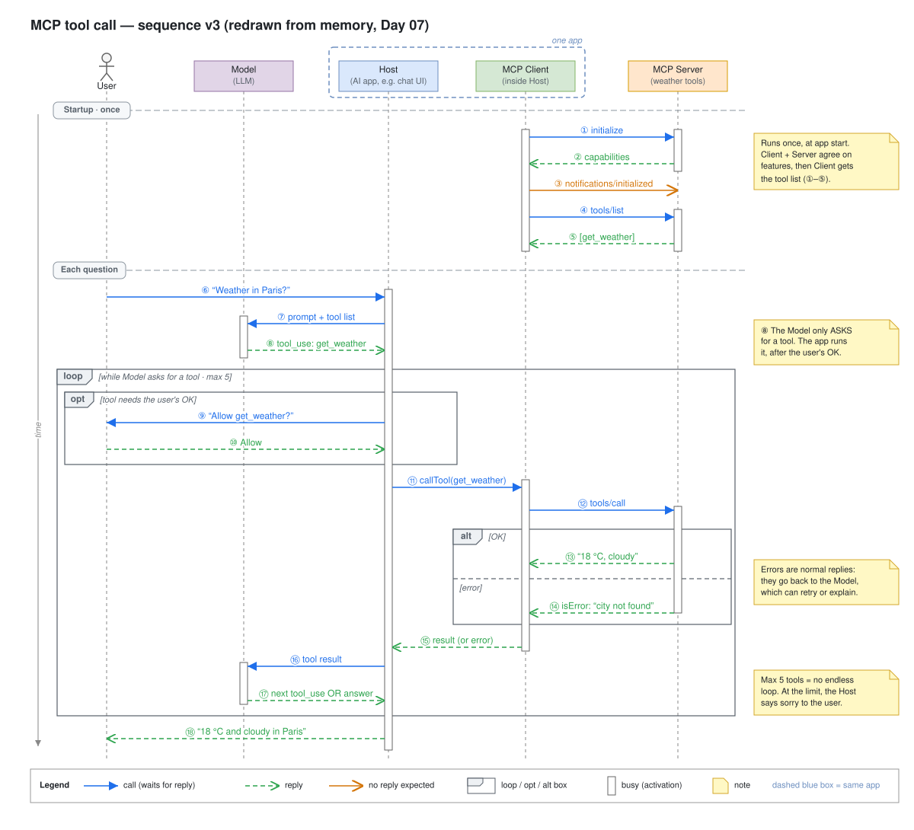

# Day 07 — Week 1 review

## What we did
- Redrew the **MCP sequence diagram from memory**: one clean picture of the whole weather story.
- Compared it with Day 05 (v1) and listed **5 improvements**.
- v3 = v1 (startup + happy path) + the best of v2 (loop, errors) + one new box (`opt`).

## Diagram

Open the `.drawio.svg` file in Draw.io (or the VS Code Draw.io extension) to edit it.

## How to read it
1. **Startup (once):** the MCP Client says hello to the Server (①–②), confirms it's ready (③, no reply), and gets the tool list (④–⑤).
2. **The question:** the user asks about the weather (⑥). The Host sends it to the Model with the tool list (⑦).
3. The Model asks for the `get_weather` tool (⑧). It only **asks**; it can't run it.
4. **`loop` box:** repeats while the Model keeps asking for tools, up to 5 times.
5. **`opt` box:** if the tool needs permission, the Host asks the user first (⑨–⑩).
6. The Host runs the tool through the MCP Client and Server (⑪–⑫).
7. **`alt` box:** the Server sends the forecast (⑬) **or** an error (⑭). Only one happens.
8. The result goes back to the Host (⑮) and then to the Model (⑯). The Model asks for another tool or writes the answer (⑰).
9. The user sees the answer (⑱).

## 5 improvements over Day 05

| # | Day 05 (v1) | Day 07 (v3) | Why it's better |
|---|---|---|---|
| 1 | Model sat between Host and MCP Client | Host + MCP Client side by side, in a **dashed "one app" box** | Shows the Client lives **inside** the Host. Tool-call arrows no longer cross the Model. |
| 2 | Startup had extra Host ↔ Client arrows (① connect, ⑦ ready) | Only the **real messages** between Client and Server | Fewer arrows, same story. Inside-the-app chatter is left out. |
| 3 | No user permission step | **`opt` box**: "Allow get_weather?" | The flowchart had this check, but the sequence was missing it. Now both match. |
| 4 | Happy path only | **`loop`** (max 5 tools) and **`alt`** (OK / error) | Shows what happens when things go wrong, without drawing a second diagram. |
| 5 | 19 steps, 4 long notes, a "calling tool…" status arrow | 18 steps, short labels, 4 short notes | Easier to read at normal zoom. Each note explains one idea. |

## When to use which (quick recap of week 1)
- **Who talks to whom, and in what order?** → Sequence diagram.
- **What gets decided, and what happens next?** → Flowchart.
- **Important design?** → Draw both. Each one shows something the other hides.

## Try it yourself
Close this file. On a blank Draw.io page, draw the 5 boxes at the top and then the arrows ①–⑱. Check yourself:
- Can you explain each arrow in one sentence?
- Did you remember which arrows are **replies** (green dashed) and which one has **no reply** (③)?
