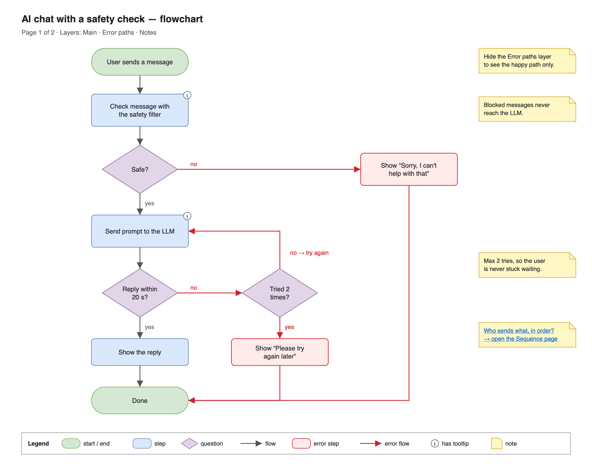
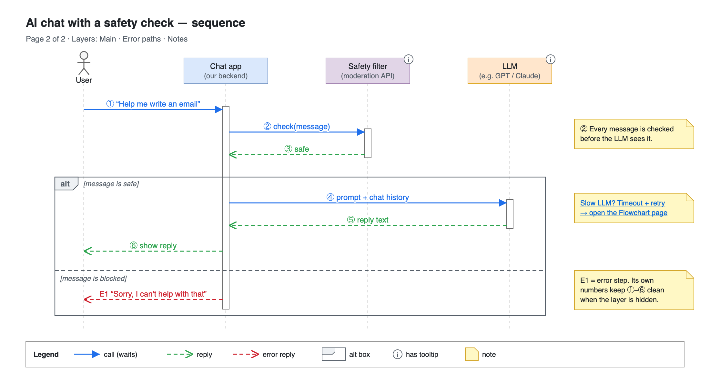

# Day 08 — Draw.io workflow

## What we did
- The workbook does this day in Mermaid. We use **Draw.io** instead, with the same goal: **one tidy source file** that is easy to change, plus image exports.
- Made **one `.drawio` file with 2 pages**: a flowchart and a sequence diagram of the same story.
- Split each page into **3 layers**: Main, Error paths, Notes.
- Added **tooltips** and **links between the pages**.
- Exported each page as a **PNG**.
- The story: an AI chat app checks every message with a **safety filter** before sending it to the LLM.

## Files
| File | What it is |
|---|---|
| [day08-chatbot-pack.drawio](./day08-chatbot-pack.drawio) | **The source.** Edit this one. Both pages are inside. |
| [day08-flowchart.png](./day08-flowchart.png) | Export of page 1 |
| [day08-sequence.png](./day08-sequence.png) | Export of page 2 |

## Page 1: flowchart

### How to read it
1. The user sends a message. The app checks it with the safety filter.
2. **Not safe?** Show "Sorry, I can't help with that". The LLM never sees it.
3. **Safe?** Send it to the LLM.
4. **Reply within 20 s?** Show it. Done.
5. **Too slow?** Try once more. After 2 tries, show "Please try again later".

Red = error paths. Turn that layer off and only the happy path is left.

## Page 2: sequence

### How to read it
1. The user sends a message (①). The app asks the safety filter (②), which says "safe" (③).
2. **`alt` box:** if the message is safe, the app asks the LLM (④–⑤) and shows the reply (⑥).
3. If it's blocked, the app says sorry (E1).

Error steps are numbered **E1, E2…** instead of ⑦, ⑧. Then ①–⑥ still read right when the error layer is hidden.

## The 3 new Draw.io skills

| Skill | What it does | Where to find it |
|---|---|---|
| **Pages** | Several diagrams in one file, shown as tabs at the bottom | Click **+** next to the page tabs |
| **Layers** | Like see-through sheets stacked on top of each other. Hide one to hide everything on it. | *View → Layers* (`Ctrl/Cmd + Shift + L`) |
| **Tooltips and links** | Hover a shape to see extra text. Click a note to jump to the other page. | Right-click → *Edit Tooltip* / *Edit Link* |

**Our 3 layers:**
- **Main:** the happy path. It's always on.
- **Error paths:** the red boxes and arrows, and the `alt` box.
- **Notes:** the yellow notes. Hide them for a clean slide.

Shapes with an **ⓘ** in the PNG have a tooltip. Open the `.drawio` file and hover over them to read it.

## Key ideas
- **One source, many pictures.** Keep the `.drawio` file next to the docs. The PNGs are just copies, so re-export them whenever you change the source.
- **Tooltips are like code comments.** They hold detail that would clutter the picture.
- **Layers let one diagram tell the story at two levels:** the happy path for a quick talk, and everything for a design review.

## Draw.io tip: export a page as PNG
*File → Export as → PNG*:
- Pick **"Selection only: off"** and the page you want.
- Set **Zoom 200%** so it stays sharp.
- Tick **"Include a copy of my diagram"** so the PNG itself can be opened and edited in Draw.io later.

Hidden layers are **not** exported. Use that to make a happy-path-only PNG.
