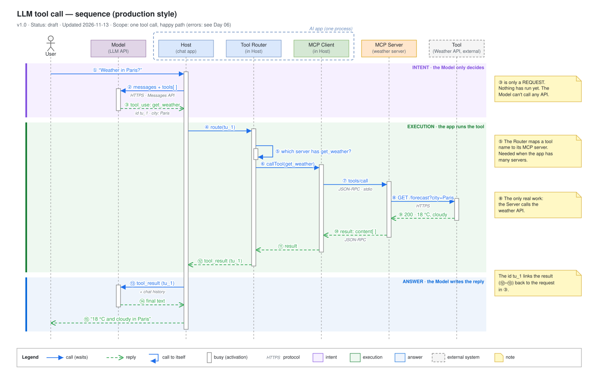

# Day 09 — Sequence patterns

## What we did
- Drew an **LLM tool call** the way a real engineering doc would show it.
- 7 participants: **User → Host → Model → Tool Router → MCP Client → MCP Server → Tool**.
- Split the story into 3 coloured bands so you can see the difference between the **Model asking** for a tool and the **app actually running** it.

## Diagram

Open the `.drawio.svg` file in Draw.io (or the VS Code Draw.io extension) to edit it.

## Who's who
| Participant | In plain words |
|---|---|
| **Host** | The chat app. It runs the show. |
| **Model** | The LLM. It reads, thinks and asks. It can't run anything itself. |
| **Tool Router** | Part of the Host. It knows which server owns which tool. |
| **MCP Client** | Part of the Host. It talks to one MCP server. |
| **MCP Server** | Offers the `get_weather` tool. |
| **Tool** | The real weather API out on the internet. Dashed box = **external** (not ours). |

Host, Tool Router and MCP Client sit in one dashed box because they run in **one app**.

## How to read it
**Purple: intent (①–③).** The user asks. The Host sends the question and the tool list to the Model. The Model replies *"please run get_weather"* and gives the request an id: **tu_1**. Nothing has run yet.

**Green: execution (④–⑫).**
1. The Host hands tu_1 to the Tool Router (④).
2. The Router asks itself which server has `get_weather` (⑤). It's an arrow that loops back to itself.
3. The call goes Router → Client → Server (⑥–⑦).
4. The Server calls the real weather API (⑧). **This is the only step that does real work.**
5. The answer comes all the way back to the Host (⑨–⑫).

**Blue: answer (⑬–⑮).** The Host gives the result to the Model, still tagged tu_1 (⑬). The Model writes the reply (⑭), and the user sees it (⑮).

## What makes it look "production"
| Thing | Why it helps |
|---|---|
| **Header line** (version, status, date, scope) | Readers know if it's current and what it covers |
| **Protocol under the arrow** (*HTTPS*, *JSON-RPC · stdio*) | Shows **how** each message travels, not just what it says |
| **Real names** (`tool_use`, `tools/call`, `GET /forecast`) | An engineer can match each arrow to the code or the logs |
| **The id `tu_1`** on the request and on the result | Shows which result answers which request |
| **Nested activation bars** | The Router stays busy, and its small extra bar shows it working on its own (⑤) |
| **Dashed boundary boxes** | Show what runs together (one app) and what's outside (external API) |

## Key idea: intent ≠ execution
- The Model **never** calls the tool. It only writes a request (③).
- The app decides whether and how to run it (④–⑫). This is where you add security, permissions and logging.
- Colouring these as two separate bands makes this obvious to anyone reading the diagram.

## Draw.io tips
- **Call to itself (⑤):** draw an arrow from a lifeline back to the same lifeline, then drag out a waypoint so it loops to the right. Put a short extra activation bar under it.
- **Bands:** a plain rectangle with no border and a light fill. Right-click → *To Back* so it sits behind everything.
- **Protocol text:** a separate small grey italic text box just under the arrow. That keeps the arrow label short.
