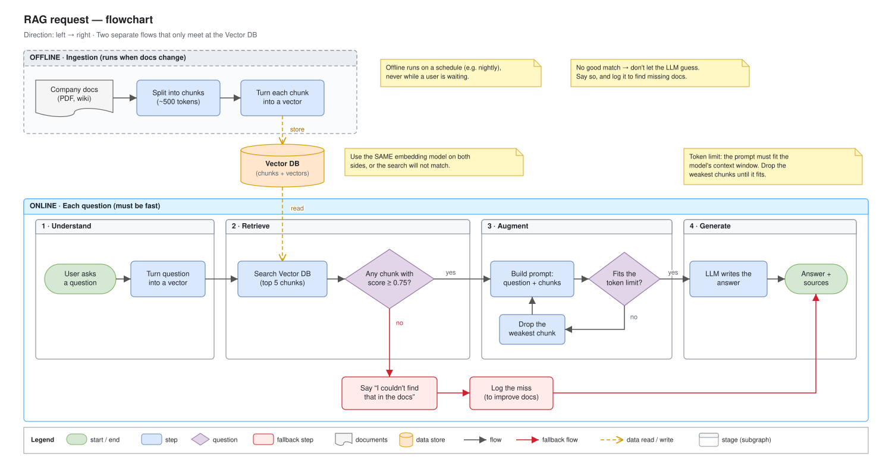

# Day 10 — Flowchart patterns

## What we did
- Drew the path of a **RAG request**: question → vector → search → build prompt → LLM → answer.
- Added a **"no results" fallback**, so the LLM never has to guess.
- Kept the **offline** part (loading the docs) apart from the **online** part (answering a question).
- New flowchart skills: **stage boxes (subgraphs)**, **decisions**, **styling by meaning**, and **left → right direction**.

**RAG** = *Retrieval-Augmented Generation*. Before the LLM answers, we look up the right pieces of our own docs and give them to it.

## Diagram

Open the `.drawio.svg` file in Draw.io (or the VS Code Draw.io extension) to edit it.

## How to read it
**Top, grey dashed box: offline (runs when docs change).**
Docs are split into small chunks, each chunk becomes a vector (a list of numbers that captures its meaning), and the vectors are saved in the **Vector DB**.

**Bottom, blue box: online (every question).** Read left to right, stage by stage:
1. **Understand:** the user asks a question. It's turned into a vector the same way.
2. **Retrieve:** search the Vector DB for the 5 closest chunks. **Is any chunk a good match (score ≥ 0.75)?**
   - **No** → say *"I couldn't find that in the docs"* and log the miss (red path).
3. **Augment:** build the prompt from the question and the chunks. **Does it fit the token limit?**
   - **No** → drop the weakest chunk and try again (small loop).
4. **Generate:** the LLM writes the answer, with the sources.

The two flows **only meet at the Vector DB**: offline **writes** to it, online **reads** from it (orange dashed arrows).

## The 4 new skills
| Skill | What it means | In this diagram |
|---|---|---|
| **Subgraph** | A labelled box that groups related steps | The Offline and Online boxes, and the 4 stages inside Online |
| **Decision** | A diamond with a yes/no question | "Any good match?" and "Fits the token limit?" |
| **Styling** | Colour shows **meaning**, not decoration | Blue = normal step, red = fallback, orange = data, grey dashed = runs offline |
| **Direction** | Which way the flow reads | **Left → right**, because it's a pipeline of stages. Earlier flowcharts went top → bottom. |

**Which direction?** Use left → right for a pipeline of stages. Use top → bottom for a process with many yes/no branches.

## Key ideas
- **Offline and online are separate.** Loading docs is slow but runs rarely. Answering must be fast. Draw them apart so nobody thinks docs get re-read on every question.
- **Use the same embedding model on both sides,** or question vectors and chunk vectors won't match.
- **A fallback beats a guess.** With no good chunks, the LLM might make something up, so we stop and say so.
- **Data arrows ≠ flow arrows.** Dashed orange = "reads/writes data". Solid = "what happens next".

## Draw.io tips
- **Subgraph:** *More shapes → Containers → Swimlane* (or *Container*). Drop shapes inside and they move with it.
- **Cylinder (database)** and **document** shapes are in the *General* and *Flowchart* panels.
- **Direction:** *Arrange → Layout → Horizontal Flow* lays out a flowchart left → right.
