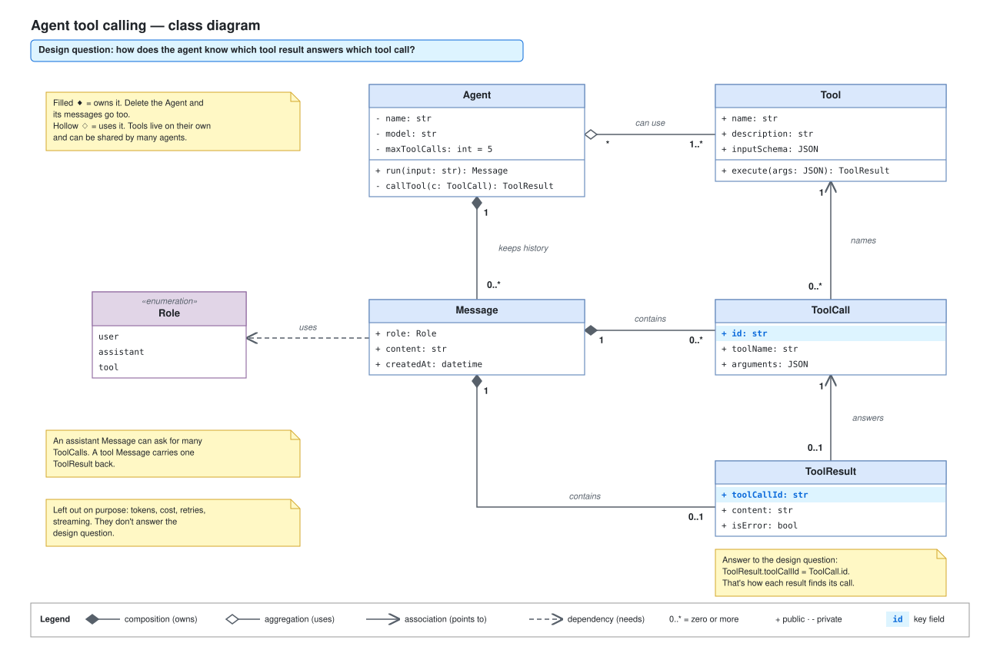

# Day 11 — Class diagrams

## What we did
- Drew our first **class diagram**: the building blocks of an AI agent that calls tools.
- 5 classes: **Agent, Tool, ToolCall, ToolResult, Message**, plus a small list called **Role**.
- Started from **one design question** and kept only the details that help answer it.

A class diagram shows **what things exist and how they're connected**, not what happens over time. That's the job of a sequence diagram.

## Diagram

Open the `.drawio.svg` file in Draw.io (or the VS Code Draw.io extension) to edit it.

## How to read a class box
Each box has up to 3 parts:
1. **Name** (top), e.g. `Agent`.
2. **Fields:** what it knows, e.g. `name: str`.
3. **Methods:** what it can do, e.g. `run(input): Message`.

`+` = anyone can use it (public). `-` = only the class itself can use it (private).
`«enumeration»` = a fixed list of values. A Message's `role` is always `user`, `assistant` or `tool`.

## How to read the diagram
1. An **Agent keeps its history** of Messages (filled ◆). One agent has zero or more messages.
2. An **Agent can use** Tools (hollow ◇). Tools exist on their own and can be shared.
3. An assistant **Message contains** zero or more **ToolCalls**: "please run these tools".
4. A tool **Message contains** zero or one **ToolResult**: "here's what the tool returned".
5. Each **ToolCall names** one Tool.
6. Each **ToolResult answers** one ToolCall. **This answers the design question:** `ToolResult.toolCallId` holds the same value as `ToolCall.id`. The two fields are highlighted in blue.

## The 4 kinds of lines
| Line | Name | Everyday words | Example here |
|---|---|---|---|
| ◆—— | **Composition** | "Owns it. If I go, it goes." | Agent ◆ Message |
| ◇—— | **Aggregation** | "Uses it, but it lives on its own." | Agent ◇ Tool |
| ——> | **Association** | "Knows about / points to." | ToolResult → ToolCall |
| - - -> | **Dependency** | "Needs it, loosely." | Message ⇢ Role |

## Multiplicity (the small numbers at line ends)
| Mark | Means |
|---|---|
| `1` | exactly one |
| `0..1` | none or one |
| `0..*` or `*` | any number, including none |
| `1..*` | at least one |

Read it from the far end. Under Message, *"one Agent has `0..*` Messages"*. Under Agent, *"each Message belongs to `1` Agent"*.

## Key idea: only what answers the design question
- We left out tokens, cost, retries and streaming on purpose. They're real, but they don't help answer *"which result belongs to which call?"*.
- A class diagram with every field becomes a wall of text nobody reads. Start from the question, then add only what helps answer it.

## Draw.io tips
- **Class box:** *More shapes → UML → Class* gives a box with name, fields and methods. Press Enter on a row to add another one.
- **Line ends:** select a line → *Format panel → Line start / Line end* → pick the diamond (◆ filled or ◇ hollow) or an open arrow.
- **Multiplicity:** a small text box near each end of the line. Keep them **close to the class they describe**.
