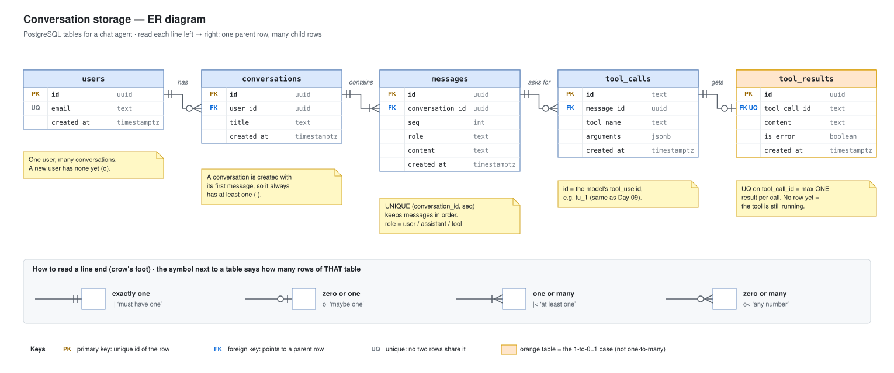

# Day 12 — ER diagrams

## What we did
- Drew an **ER diagram** (Entity–Relationship) for how a chat agent **saves** its conversations in a database.
- 5 tables: **users → conversations → messages → tool_calls → tool_results**.
- Marked the **keys** (PK, FK, UQ) and used **crow's-foot** line ends to show *how many* rows connect.

An ER diagram is like Day 11's class diagram, but for **stored data**: tables, columns and the links between them. No methods, just data.

## Diagram

Open the `.drawio.svg` file in Draw.io (or the VS Code Draw.io extension) to edit it.

## How to read it
Read each line **left → right**: one row on the left, many rows on the right.

1. A **user has** zero or many **conversations**. A brand-new user has none.
2. A **conversation contains** one or many **messages**. It's created together with its first message, so it's never empty.
3. A **message asks for** zero or many **tool calls**. Most messages ask for none.
4. A **tool call gets** zero or one **tool result**. Zero means the tool is still running. This one is **not** one-to-many, so the table is orange.

Each line runs **from the parent's `id` to the child's `FK` column**, so you can see exactly which column makes the link.

## Keys
| Key | Means | Example |
|---|---|---|
| **PK** (primary key) | The row's own unique id | `messages.id` |
| **FK** (foreign key) | Points to a row in another table: "my parent is…" | `messages.conversation_id` → `conversations.id` |
| **UQ** (unique) | No two rows can have the same value | `users.email`, `tool_results.tool_call_id` |

**The FK always sits on the "many" side.** Many messages each store their one conversation's id.

## Crow's foot in 4 symbols
The symbol **next to a table** says how many rows of **that table** take part.

| Symbol | Means | Think of it as |
|---|---|---|
| `\|\|` | exactly one | "must have one" |
| `o\|` | zero or one | "maybe one" |
| `\|<` | one or many | "at least one" |
| `o<` | zero or many | "any number" |

- `o` (circle) = **can be zero** (optional).
- `|` (bar) = **at least one** (required).
- `<` (crow's foot) = **many**.

## Key ideas
- **Clear names:** plural table names (`messages`), `snake_case` columns, and every FK named `<parent>_id`. You can guess the links before you look at the lines.
- **Cardinality is a business rule.** `|<` vs `o<` on messages is a real decision: *can a conversation be empty?* Draw what the product actually allows.
- **UQ turns one-to-many into one-to-one.** Putting UNIQUE on `tool_results.tool_call_id` is what makes it "max one result per call".

## Class diagram (Day 11) vs ER diagram (Day 12)
| | Class diagram | ER diagram |
|---|---|---|
| Shows | Objects in code | Tables in a database |
| Has methods? | Yes | No |
| Links shown with | ◆ ◇ → and `0..*` | Crow's feet and FK columns |
| Answers | "How is the code built?" | "How is the data stored?" |

## Draw.io tips
- **Tables:** *More shapes → Entity Relation → Table*. Each row is a column, with a small key cell on the left.
- **Crow's-foot lines:** select a line → *Format panel → Line start / Line end* → pick *ERmandOne*, *ERzeroToMany*, etc.
- **Connect to the column, not the table.** Drag the line end onto the exact row (`id` or the FK) so it's clear which columns link.
