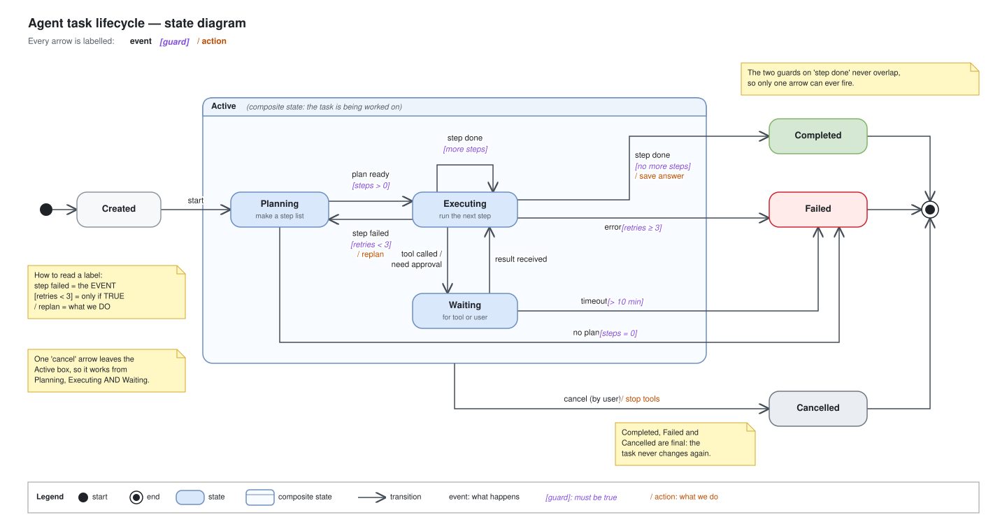

# Day 13 — State diagrams

## What we did
- Drew the **lifecycle of an agent task**: every state a task can be in, and what moves it from one state to the next.
- States: **Created → Planning → Executing → Waiting → Completed / Failed / Cancelled**.
- Every arrow has a label in the form **event [guard] / action**.

A state diagram answers *"what can this thing be, and what changes it?"* A flowchart answers *"what steps happen?"*

## Diagram

Open the `.drawio.svg` file in Draw.io (or the VS Code Draw.io extension) to edit it.

## How to read it
1. **● Start:** a task is **Created**, then **start** moves it into **Planning**.
2. **Planning:** the agent makes a list of steps.
   - **plan ready [steps > 0]** → Executing.
   - **no plan [steps = 0]** → Failed.
3. **Executing:** runs one step at a time.
   - **step done [more steps]** → loops back to itself to run the next step.
   - **step done [no more steps] / save answer** → Completed.
   - **step failed [retries < 3] / replan** → back to Planning.
   - **error [retries ≥ 3]** → Failed.
   - **tool called / need approval** → Waiting.
4. **Waiting:** for a tool result or the user's OK.
   - **result received** → back to Executing.
   - **timeout [> 10 min]** → Failed.
5. **cancel (by user)** can happen any time while the task is **Active**. One arrow from the big box covers all three states inside it.
6. **Completed, Failed, Cancelled** all lead to **◉ End**. Once there, the task never changes again.

## Reading a label
| Part | Colour | Means | Example |
|---|---|---|---|
| **event** | black | Something that **happens** | `step failed` |
| **[guard]** | purple | A condition that **must be true** for the arrow to fire | `[retries < 3]` |
| **/ action** | orange | What we **do** as we move | `/ replan` |

Only the event is required. Guards and actions are optional.

## The new notation
| Symbol | Name | Means |
|---|---|---|
| ● | Initial state | Where everything starts |
| ◉ | Final state | Where everything ends |
| Rounded box | State | A situation the task can be in for a while |
| Big box around states | Composite state | A group of states that share the same exits, like `cancel` |
| Arrow back to the same box | Self-transition | Something happens, but the state doesn't change |

## Key ideas
- **Name every arrow with an event or a condition.** An arrow with no label leaves the reader guessing *why* it happens.
- **Guards from one state must not overlap.** `[more steps]` and `[no more steps]` can't both be true, so only one arrow can fire. Same for `[steps > 0]` and `[steps = 0]`.
- **Every non-final state needs a way out,** including on errors and timeouts. Otherwise a task can get stuck forever.
- **A composite state removes repeated arrows.** Without the Active box we'd need three `cancel` arrows.

## Draw.io tips
- **States:** *More shapes → UML → State* gives rounded boxes, plus the start ● and end ◉ shapes.
- **Composite state:** use a *Container* (or swimlane) and drop the inner states into it. Draw one arrow from the container's edge.
- **Coloured labels:** select the label text and use the font colour button, so each part (event, guard, action) gets its own colour.
