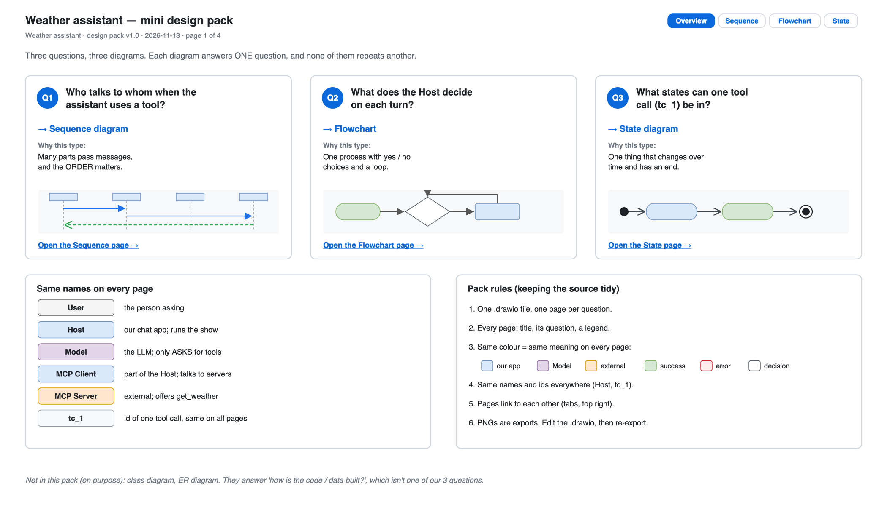
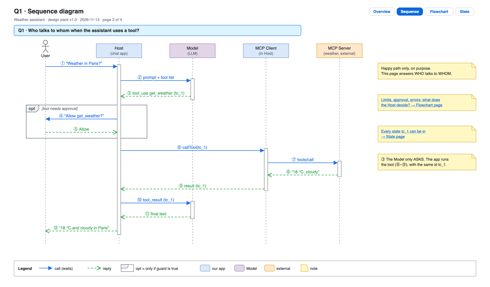
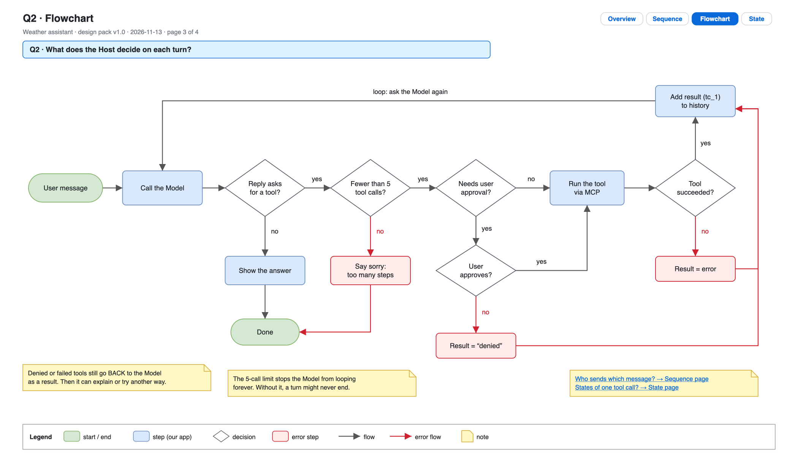
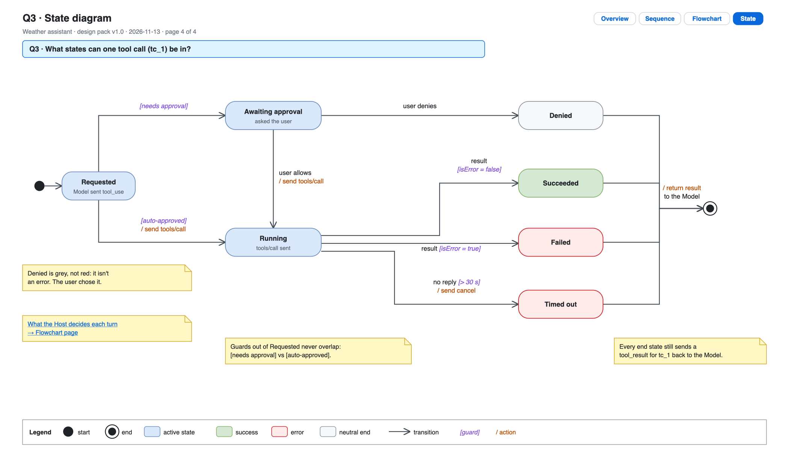

# Day 14 — Week 2 review

## What we did
- Built a **mini design pack** for a tool-using weather assistant: **one `.drawio` file with 4 pages**.
- Each diagram answers **one different question**. That's the week 2 milestone.
- Used everything from week 2: pages and links (Day 08), production-style sequence (Day 09), flowchart decisions (Day 10), state diagrams (Day 13).

## Files
| File | What it is |
|---|---|
| [day14-design-pack.drawio](./day14-design-pack.drawio) | **The source.** All 4 pages, linked by tabs in the top right of each page. |
| `day14-1-overview.png` … `day14-4-state.png` | One PNG export per page |

## Page 1: Overview

The front page sets up the pack:
- **3 questions → 3 diagram types**, each with *why this type*.
- **Same names on every page** (Host, Model, `tc_1`…).
- **Pack rules** for keeping the source tidy.

## Page 2: Sequence — *who talks to whom?*

1. The user asks (①). The Host sends the question and tools to the Model (②).
2. The Model **asks** for `get_weather` and gives the call an id, **tc_1** (③).
3. **`opt` box:** if the tool needs approval, the Host asks the user (④–⑤).
4. The Host runs the tool through the MCP Client and Server (⑥–⑨).
5. The result goes back to the Model (⑩), which writes the answer (⑪–⑫).

Happy path only. Decisions are on the next page.

## Page 3: Flowchart — *what does the Host decide?*

On every turn the Host checks, in order:
1. **Does the reply ask for a tool?** No → show the answer. Done.
2. **Fewer than 5 tool calls so far?** No → say sorry. Done.
3. **Needs user approval?** If yes, **does the user approve?** No → the result is "denied".
4. **Run the tool. Did it succeed?** No → the result is an error.
5. Add the result to the history, then **loop** back and ask the Model again.

## Page 4: State — *what states can one tool call be in?*

1. A tool call starts as **Requested**.
2. If it needs approval it goes to **Awaiting approval**. If not, it goes straight to **Running**.
3. The user can **allow** it (→ Running) or **deny** it (→ **Denied**).
4. While Running, it ends as **Succeeded**, **Failed**, or **Timed out** after 30 s.
5. Every end state sends a result back to the Model.

## Why these 3 diagrams together
| Question | Diagram | What only this one shows |
|---|---|---|
| Who talks to whom? | Sequence | The **order** of messages between 5 parts |
| What does the Host decide? | Flowchart | The **yes/no choices**, the 5-tool limit, the loop |
| What states can a tool call be in? | State | The **life** of one tool call, including Denied and Timed out |

**No overlap test:** if two diagrams answer the same question, delete one. If a question has no diagram, add one.

We left out the **class** and **ER** diagrams on purpose. They answer *"how is the code / data built?"*, which isn't one of this pack's questions.

## Pack rules (keeping the source tidy)
1. **One source file, one page per question.** PNGs are only exports.
2. **Every page:** title, its question in a blue banner, a legend.
3. **Same colour = same meaning on every page:**
   - blue = our app
   - purple = Model
   - orange = external
   - green = success
   - red = error
   - white diamond = decision
4. **Same names and ids everywhere.** `tc_1` is the same tool call on all 3 diagram pages.
5. **Pages link to each other** through tabs and yellow link notes.

## Week 2 milestone check
> *Do my flowchart, sequence and state diagrams each answer a distinct question?*

Yes. Each page has its own question, and the table above shows what only that page reveals.

## Draw.io tips
- **Link to another page:** select a shape → *Edit → Edit Link* → pick *Page* and the page name.
- **Reuse styles:** style one shape, then *Edit Style* → copy the text, or use *Copy/Paste Style* (`Ctrl/Cmd + Shift + C / V`).
- **Export all pages:** *File → Export as → PNG* → untick *Selection only* and pick each page in turn.
