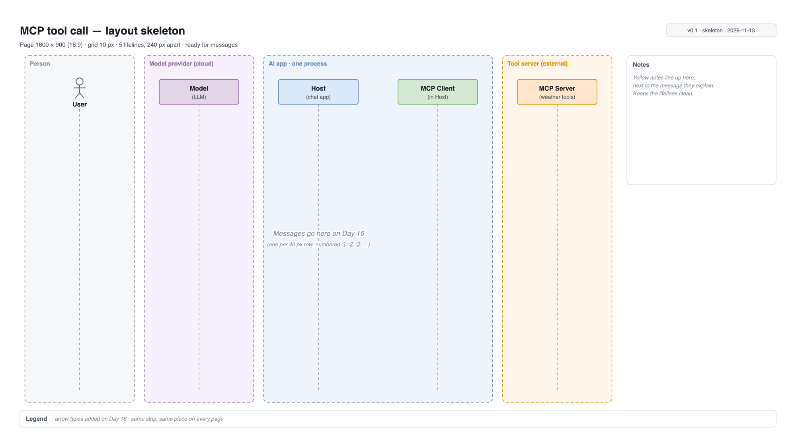
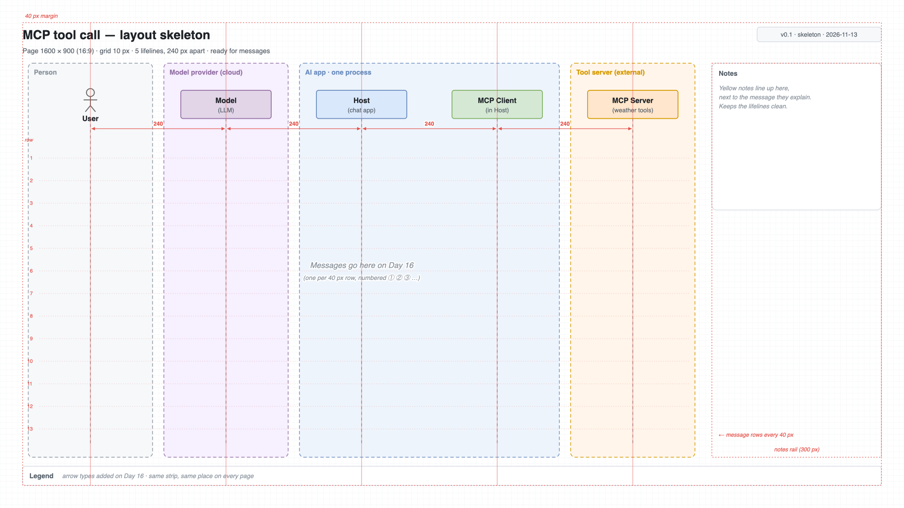

# Day 15 — Canvas setup

## What we did
- Week 3 is about making diagrams **look professional**. It starts before you draw a single arrow: **set up the page first**.
- Built an **MCP layout skeleton**: the 5 participants on a clean, measured canvas, with **no messages yet**.
- Days 16 and 17 add the arrows and polish on top of this file.

## Files
| File | What it is |
|---|---|
| [day15-mcp-skeleton.drawio](./day15-mcp-skeleton.drawio) | **The source.** Open it and look at *View → Layers*. |
| [day15-skeleton.png](./day15-skeleton.png) | Export with the Guides layer **hidden**: what readers will see |
| [day15-skeleton-guides.png](./day15-skeleton-guides.png) | Export with the Guides layer **on**: the measurements behind the layout |

## The skeleton

## The measurements behind it

Red = guides only. They're on their own layer, so hiding it removes them all at once.

## How it's laid out
1. **Page:** 1600 × 900, the shape of a 16:9 slide, so it drops straight into a presentation.
2. **Grid:** 10 px. Every shape sits on the grid, so edges line up by themselves.
3. **Margin:** 40 px of empty space on every side.
4. **Lifelines:** exactly **240 px apart**, all the same size (160 × 50).
5. **Zones** (dashed boxes) show what runs where:
   - **Person:** the User.
   - **Model provider:** the LLM, in the cloud.
   - **AI app:** Host and MCP Client, in **one process**.
   - **Tool server:** the external MCP Server.
6. **Message rows:** every 40 px. On Day 16 each arrow goes on its own row.
7. **Notes rail:** a 300 px column on the right for yellow notes, so notes never cover the lifelines.
8. **Legend strip:** same place at the bottom of every page.

## The 5 layers
| Layer | What's on it | Show in export? |
|---|---|---|
| **Guides** | Margins, centre lines, spacing, rows | No, for building only |
| **Zones** | The 4 dashed boxes | Yes |
| **Lifelines** | The 5 participants | Yes |
| **Messages** | Empty for now (Day 16) | Yes |
| **Frame** | Title, version, notes rail, legend | Yes |

**Why layers?** Lock the Zones and Lifelines layers while you draw messages, so you can't knock them out of place by accident.

## Key ideas
- **Decide the page size, grid and spacing first.** Moving 5 lifelines later means fixing every arrow.
- **Equal spacing looks deliberate.** 240 px between every lifeline makes the diagram feel calm and ordered.
- **Leave room for what's coming:** rows for arrows, a rail for notes, a strip for the legend.
- **The order is from Day 07:** Model sits left of Host, so Host and MCP Client can share one "AI app" zone.

## Draw.io how-to
| Task | Where |
|---|---|
| Page size | *File → Page Setup* → Custom: 1600 × 900 |
| Grid size | *View → Grid* on; right panel (no selection) → *Grid* = 10 |
| Snap to grid | *Arrange → Snap to Grid* (`Alt` while dragging = no snap) |
| Lifeline shape | *More shapes → UML → Lifeline* |
| Layers panel | *View → Layers* (`Ctrl/Cmd + Shift + L`). Click the lock icon to lock a layer. |
| Line things up | Select shapes → *Arrange → Align → Center* / *Distribute → Horizontally* |
| Exact size/position | Select a shape → *Arrange* tab → type the x, y, width and height |
