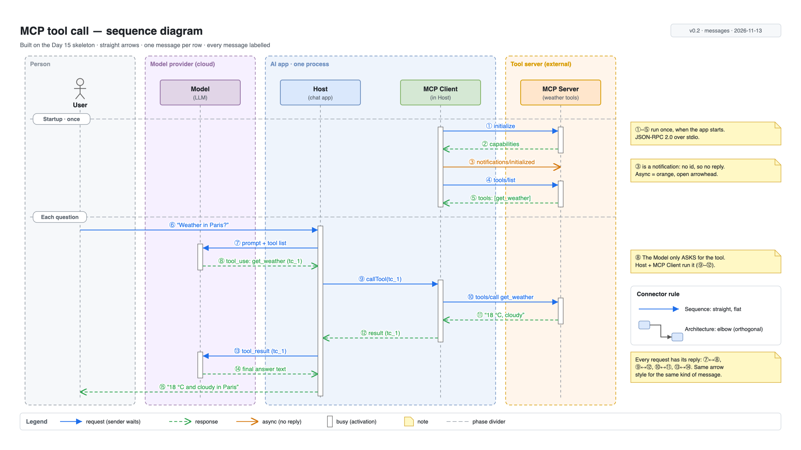

# Day 16 — Shapes and connectors

## What we did
- Took the **Day 15 skeleton** and drew the full **MCP sequence** on it: 15 messages, from app startup to the user's answer.
- Used **one arrow style per kind of message**, so the reader learns the style once and can read every arrow.
- **Labelled every message** and numbered them ①–⑮.

## Files
| File | What it is |
|---|---|
| [day16-mcp-sequence.drawio](./day16-mcp-sequence.drawio) | **The source.** Same 5 layers as Day 15. The arrows are on the *Messages* layer. |
| [day16-mcp-sequence.png](./day16-mcp-sequence.png) | Export, guides hidden |
| [day16-mcp-sequence-guides.png](./day16-mcp-sequence-guides.png) | Export with guides on: shows each message sitting on its row |

## Diagram

## How to read it
**Startup, once (①–⑤).** The MCP Client says hello to the Server (①–②) and confirms it's ready (③, no reply). Then it gets the tool list (④–⑤).

**Each question (⑥–⑮).**
1. The user asks (⑥). The Host sends the question and tool list to the Model (⑦).
2. The Model **asks** for `get_weather`, with id **tc_1** (⑧).
3. The Host runs it through the MCP Client and Server (⑨–⑩). The forecast comes back (⑪–⑫).
4. The Host gives the result to the Model (⑬), which writes the answer (⑭). The user sees it (⑮).

## One style per kind of message
| Arrow | Looks like | Use it for | Examples |
|---|---|---|---|
| **Request** | Blue, solid, filled head | "Do this." The sender **waits** | ①, ④, ⑦, ⑩ |
| **Response** | Green, dashed, open head | The answer to a request | ②, ⑤, ⑧, ⑪ |
| **Async** | Orange, solid, open head | "FYI." **No answer** expected | ③ |

**Every request has its response:** ⑦↔⑧, ⑨↔⑫, ⑩↔⑪, ⑬↔⑭. If a blue arrow has no green partner, either it's a mistake or it should be orange.

## Connector rule
| Diagram | Connector | Why |
|---|---|---|
| **Sequence** | **Straight**, flat, left ↔ right | Each arrow is one moment in time. A bend would look like time passing. |
| **Architecture** | **Elbow** (orthogonal: only horizontal and vertical lines) | Boxes sit in a grid, so right angles keep lines tidy and easy to follow. |

## Labels
- **Above the arrow,** centred, in the arrow's colour.
- **Number first** (①), then the **real name** where there is one (`tools/list`, `tool_use`), or the content in quotes ("Weather in Paris?").
- **Short.** Details go in a yellow note in the notes rail, next to the message.

## What changed from the skeleton
- The rows went from **40 px to 36 px**. 15 messages plus 2 phase dividers didn't fit at 40. This is normal: the skeleton is a plan, and you adjust it once the content is real.
- The legend strip is now filled in, and the notes rail holds real notes.

## Draw.io how-to
| Task | Where |
|---|---|
| Message arrow | Drag from one lifeline to another. Hold `Shift` to keep it flat. |
| Make it dashed / change the head | Select the arrow → *Format → Line* → *Pattern* and *Line end* |
| Reuse a style | Style one arrow → *Edit Style* → copy, or `Ctrl/Cmd + Shift + C`, then `Ctrl/Cmd + Shift + V` on the others |
| Straight vs elbow | Select an arrow → *Format → Waypoints* → *Straight* or *Orthogonal* |
| Activation bar | A thin 10 px wide rectangle on the lifeline, from the first arrow in to the last arrow out |
