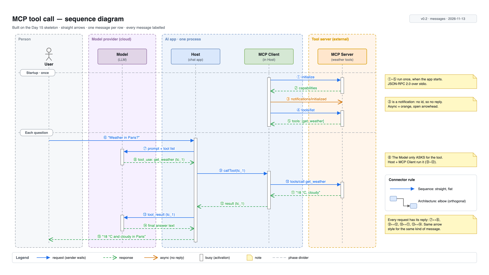
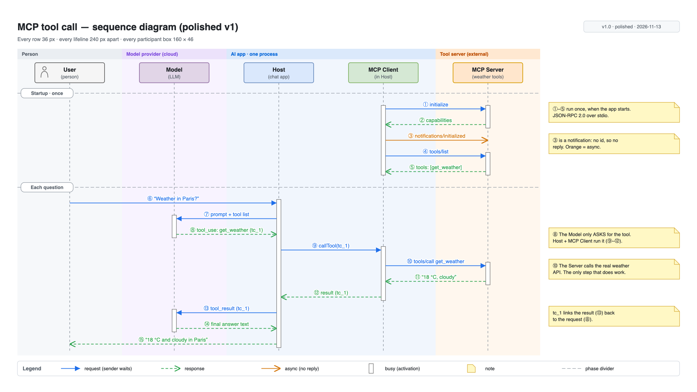

# Day 17 — Layout and alignment

## What we did
- Took the **Day 16** MCP sequence and **polished** it. Same story, same 15 messages: only the layout changed.
- Every position now comes from a few fixed numbers: **240 px** columns, **36 px** rows, **160 × 46** boxes, **8 px** padding on activation bars.
- Result: **Polished MCP diagram v1**.

## Files
| File | What it is |
|---|---|
| [day17-mcp-sequence-v1.drawio](./day17-mcp-sequence-v1.drawio) | **The source** (same 5 layers as Day 15) |
| [day17-mcp-sequence-v1.png](./day17-mcp-sequence-v1.png) | Clean export |
| [day17-mcp-sequence-v1-guides.png](./day17-mcp-sequence-v1-guides.png) | Export with guides on: columns, rows, and note alignment |

## Before (Day 16)

## After (Day 17)

## The measurements behind it

## What we fixed
| # | Problem in Day 16 | Fix in Day 17 |
|---|---|---|
| 1 | Arrow labels crossed the dashed zone borders | Zones are now **soft colour bands with no borders and no gaps**. Labels never hit an edge. |
| 2 | The gap around "Each question" was **54 px**, every other gap 36 px | **Every row is 36 px**, phase dividers included. Even rhythm top to bottom. |
| 3 | User was a bare stick figure, everyone else had a box | **All 5 participants use the same 160 × 46 box.** User gets a small person icon inside. |
| 4 | Notes floated near their message | **Each note's first line sits on its message's row** (red ticks in the guides view). |
| 5 | Activation bars started and stopped at random-looking points | Every bar starts **8 px before** its first arrow and ends **8 px after** its last. |
| 6 | Legend items were spaced by eye | **Equal 230 px slots**, like *Arrange → Distribute*. |
| 7 | Left edges didn't quite match (zones at 50, title at 40) | **Everything lines up at x = 40**: title, zones, phase dividers, legend. Right edges at 1560. |

## Key ideas
- **Use numbers, not your eyes.** Pick a few measurements and reuse them everywhere. A "nearly lined up" edge looks worse than one that's clearly off.
- **Vertical rhythm:** the same gap between every row lets the eye scan down the page without stumbling.
- **Same thing, same size.** All participants are equally important, so they all get the same box.
- **Remove lines you don't need.** The zone borders added noise. Colour alone shows the zones.

## Draw.io how-to
| Task | Where |
|---|---|
| Line up edges / centres | Select shapes → *Arrange → Align → Left / Center / Middle* |
| Even spacing | Select 3+ shapes → *Arrange → Distribute → Horizontally / Vertically* |
| Same size | Select shapes → *Arrange* tab → type the same Width and Height for all |
| Snap | *View → Grid* and *Arrange → Snap to grid*. Hold `Alt` to move freely. |
| Nudge by 1 px | Arrow keys. `Shift` + arrow = one grid step. |
| Group | Select → `Ctrl/Cmd + G`. It moves as one, e.g. a note with its tag. |
| Lock while you work | *View → Layers* → padlock on Zones and Lifelines |
