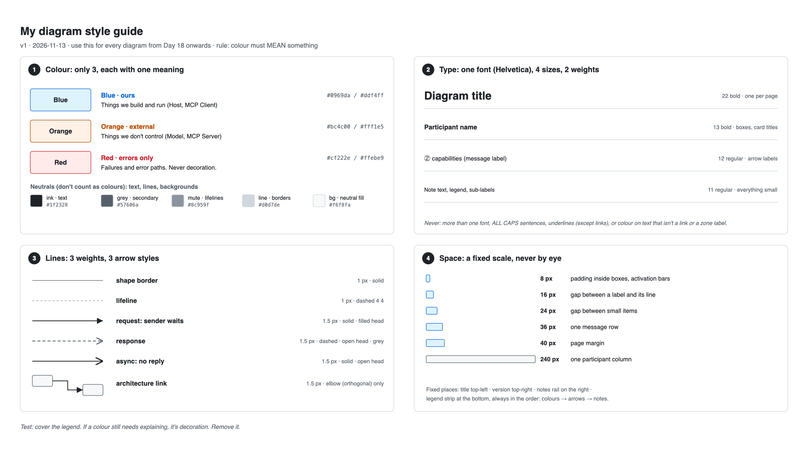
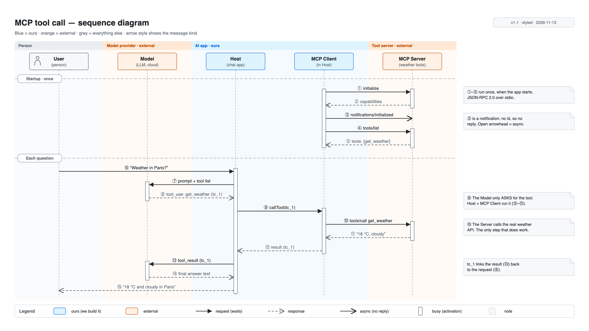

# Day 18 — Visual design system

## What we did
- Wrote a **personal style guide**: 3 colours, 1 font, fixed line weights, a spacing scale, and fixed spots for the title and legend.
- **Restyled the Day 17 MCP diagram** with it. Same layout and messages, new visual language.
- Main rule: **colour must mean something.** No colour just to look nice.

## Files
| File | What it is |
|---|---|
| [STYLE_GUIDE.md](./STYLE_GUIDE.md) | **The style guide** in text form. Reuse it on every future day. |
| [day18-style-guide-and-mcp.drawio](./day18-style-guide-and-mcp.drawio) | Source with 2 pages: *Style guide* and *MCP sequence (styled)* |
| [day18-style-guide.png](./day18-style-guide.png) | Style guide page |
| [day18-mcp-sequence-styled.png](./day18-mcp-sequence-styled.png) | Restyled MCP diagram |

## Style guide

## MCP diagram, restyled

## Before and after
| | Day 17 (v1) | Day 18 (styled) |
|---|---|---|
| Colours | **~10:** a different one for every participant, 3 arrow colours, 4 zone tints, yellow notes | **3:** blue, orange, and red (kept for errors) |
| What colour tells you | Nothing really. Purple Model, green Client… just decoration. | **Who owns it:** blue = ours, orange = external |
| How you tell arrows apart | By colour (blue / green / orange) | By **line style**: solid + filled head, dashed, open head |
| Notes | Yellow | Neutral grey. They're comments, not a category. |
| Line widths | Mixed (1, 1.2, 1.5) | **3 fixed weights:** 1 px shapes, 1 px dashed lifelines, 1.5 px arrows |

**What the reader learns now just from colour:** the Model and the MCP Server are both **outside our control**. That matters for security, cost and reliability. Before, the colours hid it.

## Key ideas
- **Few colours, each with one meaning.** Three is plenty. Every extra colour is one more thing to explain.
- **Use line style for type and colour for category.** Then they never clash.
- **Neutrals are free.** Text, borders and backgrounds in greys don't count against your 3.
- **One font, few sizes.** The size alone shows what's a title, a name, a label or a note.
- **Write the style down,** so diagram #10 looks like diagram #1.

## Draw.io tips
- **Set the font for everything:** select all (`Ctrl/Cmd + A`) → *Format → Text* → Helvetica.
- **Copy and paste styles:** `Ctrl/Cmd + Shift + C` on a styled shape, then `Ctrl/Cmd + Shift + V` on others.
- **Save colours:** *Format → Fill → ⋯ (more colours)*. Draw.io remembers recent colours, so you can pick yours fast.
- **Default style:** style one shape → *Edit → Set as Default Style*. New shapes start in your style.
