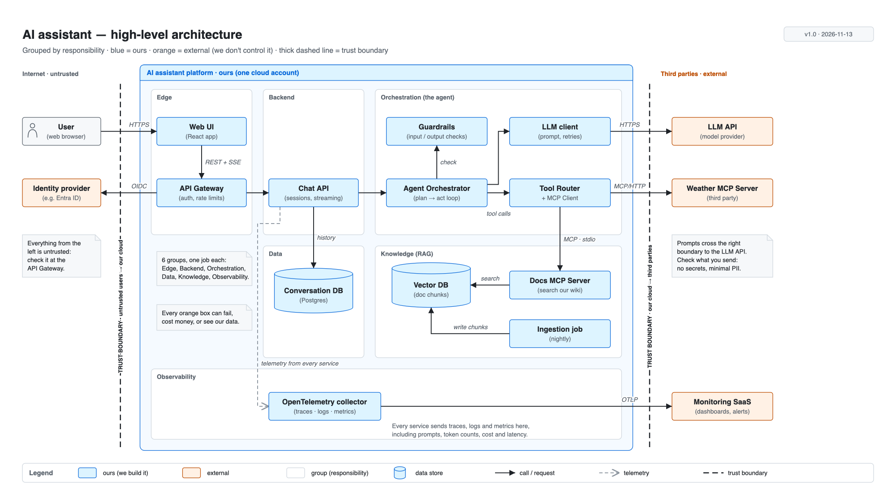

# Day 19 — Architecture composition

## What we did
- Drew our first **architecture diagram**: the whole AI assistant on one page, at a high level.
- It covers the UI, API/backend, orchestration, model provider, MCP tools, data stores and observability.
- Grouped the parts by **responsibility**, marked what's **ours vs external**, and drew the two **trust boundaries**.
- Used the **Day 18 style guide**: blue = ours, orange = external, elbow connectors only.

## Files
| File | What it is |
|---|---|
| [day19-ai-assistant-architecture.drawio](./day19-ai-assistant-architecture.drawio) | **The source** |
| [day19-ai-assistant-architecture.png](./day19-ai-assistant-architecture.png) | Export |

## Diagram

## How to read it
Read left → right, following a question.

1. **Left, outside our cloud:** the **User** opens the **Web UI** over HTTPS. The **Identity provider** (orange: not ours) checks who they are.
2. **Edge:** the **API Gateway** is the front door. It checks the login and limits how many requests a user can send.
3. **Backend:** the **Chat API** keeps track of conversations and streams the answer back. It saves history in the **Conversation DB**.
4. **Orchestration (the agent):** the **Agent Orchestrator** runs the plan → act loop.
   - **Guardrails** check what goes in and what comes out.
   - The **LLM client** talks to the **LLM API** (orange).
   - The **Tool Router + MCP Client** calls tools: the **Weather MCP Server** (orange, third party) or our own **Docs MCP Server**.
5. **Knowledge (RAG):** the Docs MCP Server searches the **Vector DB**. A nightly **Ingestion job** fills it.
6. **Observability:** every service sends traces, logs and metrics to the **OpenTelemetry collector**. It forwards them to a **Monitoring SaaS** (orange).

## The 4 ideas from today
| Idea | What it means | In this diagram |
|---|---|---|
| **Boundary** | A box around what belongs together | The big blue box: everything we run in our cloud |
| **Group (container)** | Parts with the same job | Edge, Backend, Orchestration, Data, Knowledge, Observability |
| **External system** | Something we use but don't control | 4 orange boxes: Identity provider, LLM API, Weather MCP Server, Monitoring SaaS |
| **Trust boundary** | Where data crosses into or out of a zone we trust | 2 thick dashed lines: users → our cloud (check all input), our cloud → third parties (watch what data leaves) |

## Key ideas
- **Group by job, not by technology.** "Orchestration" tells the reader more than "Python services".
- **External systems are risks.** Each orange box can go down, cost money, or see our data. Make them easy to spot.
- **Trust boundaries show where to be careful.** Anything coming in from the left is untrusted. Anything going out on the right, like prompts sent to the LLM, leaves our control.
- **High level means boxes and arrows only.** Message order belongs in a sequence diagram (Days 16–18), not here.
- **Label every arrow with its protocol** (HTTPS, OIDC, MCP/HTTP, MCP · stdio, OTLP), so engineers know how the parts actually talk.

## Draw.io tips
- **Boundary and groups:** use *Container* or *Swimlane* shapes. Drop boxes inside and they move together.
- **Elbow connectors:** select an arrow → *Format → Waypoints → Orthogonal*. Drag the middle handle to route it around boxes.
- **Trust boundary:** a plain line, 2 px, dashed. Rotate its label with *Arrange → Rotate* or *Format → Text → Rotation = −90*.
- **Data store:** the *Cylinder* shape in the General panel.
