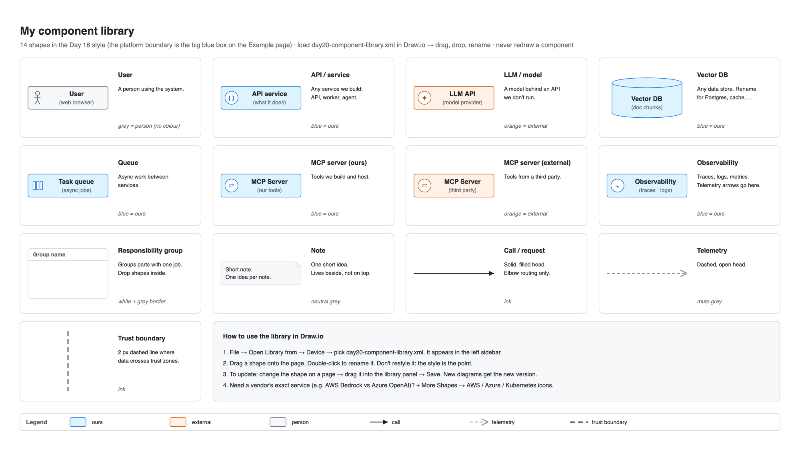
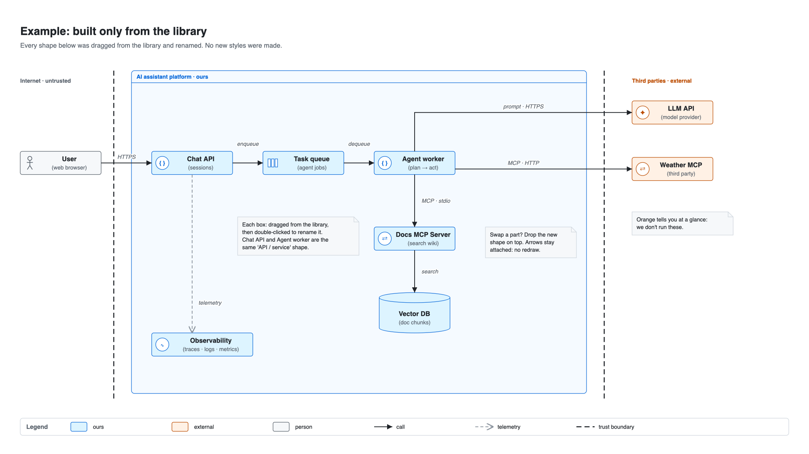

# Day 20 — Reusable components and icons

## What we did
- Built a **Draw.io component library**: a file of ready-made shapes you drag onto any diagram.
- 14 shapes, all in the **Day 18 style**:
  - **Components:** User, API/service, LLM/model, Vector DB, Queue, MCP server (ours and external), Observability.
  - **Building blocks:** group, platform boundary, note, and 3 line types.
- Drew a **library sheet** that explains each shape, plus an **example** built only from library shapes.

## Files
| File | What it is |
|---|---|
| [day20-component-library.xml](./day20-component-library.xml) | **The library.** Open it in Draw.io and it shows up in the left sidebar. |
| [day20-components.drawio](./day20-components.drawio) | 2 pages: *Library sheet* and *Example* |
| [day20-sheet.png](./day20-sheet.png) | Library sheet export |
| [day20-example.png](./day20-example.png) | Example export |

## The library sheet

## Example: built only from the library

## How to read the example
1. The **User** calls the **Chat API**. The API puts the job on a **Task queue**.
2. The **Agent worker** takes the job. It asks the **LLM API** (orange: external) and calls tools: the **Weather MCP** (external) or our **Docs MCP Server**, which searches the **Vector DB**.
3. The Chat API sends **telemetry** to **Observability**.

Chat API and Agent worker are **the same library shape** with different names.

## How to use the library
1. **Open it:** *File → Open Library from → Device* → pick `day20-component-library.xml`. A new panel appears in the left sidebar.
2. **Use a shape:** drag it onto the page, then double-click to rename it. **Don't change its colours.** Matching style is the whole point.
3. **Update a shape:** change it on a page → drag it into the library panel (or click ✎ to edit) → **Save**. New diagrams get the new version.
4. **Swap a part:** drop the new shape on top of the old one. Arrows stay attached, so you don't have to rebuild the diagram.

## Generic shapes or vendor icons?
| Use… | When | Example |
|---|---|---|
| **Our generic shapes** (this library) | The **role** matters, not the brand | "an LLM API", "a queue", "a vector DB" |
| **Official vendor icons** (AWS, Azure, Kubernetes) | The **exact product** matters to the reader | AWS SQS vs Azure Service Bus · Bedrock vs Azure OpenAI · a Kubernetes Pod |

Turn vendor icons on in Draw.io with *+ More Shapes* → tick **AWS**, **Azure** or **Kubernetes**. Rule of thumb:
- **High-level** diagrams (Day 19) → generic shapes.
- **Deployment** diagrams (Day 27) → vendor icons.

## Key ideas
- **Draw a component once and reuse it forever.** Every diagram gets the same look for free.
- **Icons help you scan.** The small badge (`{ }` API, `✦` model, `⇄` MCP, `∿` observability, slots for a queue) lets you spot the type before you read the label.
- **One shape can play many roles.** API / service covers APIs, workers and agents. Fewer shapes means a smaller library to remember.
- **Keep the meaning in the library.** Blue = ours and orange = external are baked in, so a diagram can't drift from the style guide.

## Draw.io tips
- **Make a component:** build it from a box plus an icon → select both → `Ctrl/Cmd + G` (group) → drag the group into the library panel.
- **Name it:** in the library panel, hover a shape → ✎ → give it a title. The title is what search finds.
- **Share it:** the `.xml` file is the whole library. Commit it to git with your diagrams.
