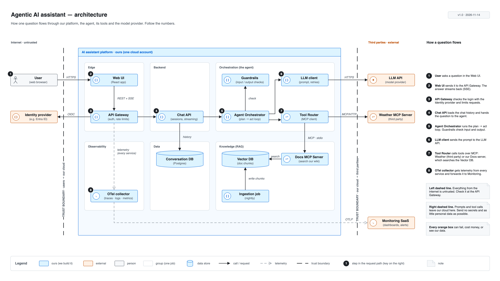

# Day 21 — Week 3 review: presentation-ready architecture

## What we did
- Rebuilt the **Day 19 AI assistant architecture** so it is ready to put on a slide.
- Used only **Day 20 library shapes** and the **Day 18 style guide**.
- Added **numbered steps** (1–8) and a **step key**, so people can follow one question through the system.
- Exported it as **SVG** and **PNG**.

## Files
| File | What it is |
|---|---|
| [day21-agentic-ai-architecture.drawio](./day21-agentic-ai-architecture.drawio) | **The source** |
| [day21-agentic-ai-architecture.drawio.svg](./day21-agentic-ai-architecture.drawio.svg) | SVG export. Sharp at any size, and still opens in Draw.io |
| [day21-agentic-ai-architecture.png](./day21-agentic-ai-architecture.png) | PNG export at 2× (3840 × 2160) for slides |

## Diagram

## How to read it
Follow the black numbers. The key on the right says what each one does.

1. The **User** asks a question in the **Web UI**.
2. The **Web UI** sends it to the **API Gateway**. The answer streams back the same way.
3. The **API Gateway** checks the login with the **Identity provider** (orange: not ours).
4. The **Chat API** loads the chat history from the **Conversation DB** and passes the question on.
5. The **Agent Orchestrator** runs the plan → act loop. **Guardrails** check what goes in and out.
6. The **LLM client** sends the prompt to the **LLM API** (orange).
7. The **Tool Router** calls tools: the **Weather MCP Server** (orange) or our **Docs MCP Server**, which searches the **Vector DB**.
8. The **OTel collector** gets telemetry from every service and sends it to **Monitoring SaaS** (orange).

## What changed from Day 19
| Day 19 | Day 21 |
|---|---|
| No reading order | **Numbered steps** + a key on the right |
| Notes scattered inside the platform | All notes in **one notes rail** on the right |
| Plain boxes | **Library shapes with icons** (`{ }` service, `✦` model, `⇄` MCP, `∿` telemetry) |
| Labels sitting on the trust boundary lines | Labels moved into the **gap** between box and line |
| Tight 24 px gap inside the agent group | **48 px** gap, so arrows have room |
| Odd 1600 × 900 page | **1920 × 1080 (16:9)**, fits a slide with no resizing |

## Key ideas
- **Give the reader a path.** Numbers turn "a lot of boxes" into a story you can tell in one minute.
- **Same thing, same place.** Title top-left, version top-right, notes on the right, legend at the bottom. Every diagram.
- **Fix collisions first.** A label on top of a line is the first thing people notice. Move it into empty space.
- **Export both formats.** SVG for docs and the web (stays sharp). PNG at 2× for slides and chat.

## Draw.io tips
- **Slide size:** *File → Page Setup* → Custom → 1920 × 1080.
- **Export PNG:** *File → Export as → PNG* → Zoom **200%**, Border **0**, tick *Selection only* off.
- **Export SVG you can edit later:** *File → Export as → SVG* → tick **Include a copy of my diagram**. The file opens in Draw.io again.
- **Check before you export:** press `Ctrl/Cmd + Shift + H` (fit page) and look for any label touching a line.
